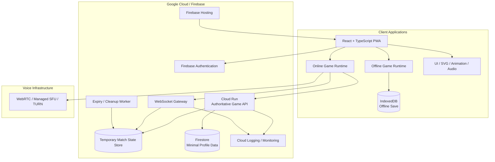
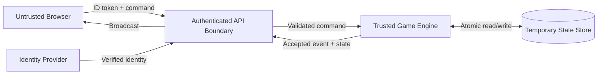
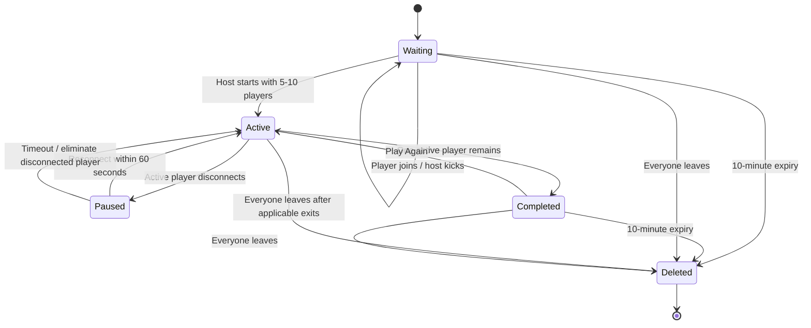

# System Architecture

**Project:** Ancient Magical Book Multiplayer Game  
**Document:** `arch.md`  
**Version:** 1.0  
**Status:** Proposed architecture baseline  

## 1. Architecture goals

The architecture must:

1. Support offline local multiplayer without internet.
2. Support online private rooms with 5–10 active players and additional spectators.
3. Keep online gameplay server-authoritative.
4. Recover active matches after refreshes and temporary disconnections.
5. Minimize persistent storage and automatically delete temporary match data.
6. Separate game rules from UI, networking, persistence, and animation.
7. Keep initial infrastructure operationally simple and cost-conscious.
8. Support desktop, mobile browsers, and installable PWA.

## 2. High-level architecture



This is a logical architecture. The exact deployment topology for WebSockets and temporary state must be validated against the selected Cloud Run configuration and expected concurrency.

## 3. Major components and ownership

### 3.1 Web client

**Technology:** React, TypeScript, Vite, Tailwind CSS, PWA.

Responsibilities:
- Render menus, profile, lobby, battlefield, book, combat, victory, and settings screens.
- Support desktop, tablet, and mobile layouts.
- Render the active game state received from the local engine or online server.
- Collect player commands and send them through the appropriate runtime.
- Play animations and audio after accepted state changes.
- Display loading, reconnecting, eliminated, spectator, and error states.
- Provide offline application shell and local match recovery.

The client is not authoritative for online game state.

### 3.2 Shared game-engine package

**Technology:** Pure TypeScript package.

Responsibilities:
- Define player, cell, weapon, turn, room, and match types.
- Validate legal game transitions.
- Implement progression, bullet allocation, shooting, destruction, elimination, and victory.
- Provide deterministic transition functions.
- Expose state selectors for UI rendering.
- Contain no browser, database, network, or framework dependencies.

Use the same rules package in offline mode and on the server where practical. The server still validates all commands independently against its trusted state.

### 3.3 Offline runtime

Responsibilities:
- Create and manage a local match on one shared device.
- Enforce local turn order and available actions.
- Generate outcomes using browser cryptographic randomness.
- Apply game-engine transitions locally.
- Persist accepted state to IndexedDB after each action.
- Restore the previous match after refresh or browser reopening.
- Never upload offline match state.

Offline mode relies on shared-device trust. It does not provide online anti-cheat guarantees.

### 3.4 Authentication and profile service

**Technology:** Firebase Authentication and Firestore.

Responsibilities:
- Google sign-in and email/password sign-in.
- Unique username registration and validation.
- Username change cooldown of 30 days.
- Built-in avatar selection and predefined cosmetic variants.
- Minimal progression state for earned cosmetics, if implemented.

Persist only essential profile data. Do not persist completed match history or player performance records.

### 3.5 Authoritative game service

**Technology:** TypeScript service deployed to Cloud Run.

Responsibilities:
- Create, join, start, and close rooms.
- Verify identity and room membership.
- Assign player positions at match start.
- Maintain authoritative online match state.
- Validate all gameplay commands.
- Generate secure random outcomes and verifiability proofs.
- Enforce turn order and shooting rules.
- Resolve eliminations, wins, rematches, and host transfer.
- Manage disconnect deadlines and reconnects.
- Produce temporary match reports for the host.
- Trigger cleanup when a room closes or expires.

The server must reject any action that is invalid for the current authoritative state.

### 3.6 Realtime gateway

Responsibilities:
- Authenticate WebSocket connections.
- Subscribe clients to authorized room channels.
- Broadcast accepted state changes and event notifications.
- Deliver the same book outcome and match event to all room participants.
- Track connection presence and reconnect identity.
- Deliver chat and reaction events subject to rate limits.

Do not let clients publish authoritative game events directly. Client messages are commands or communication payloads, not trusted state changes.

### 3.7 Temporary match-state store

Responsibilities:
- Hold active room and match state.
- Hold temporary event history and randomness verification data.
- Support atomic state transitions and concurrency control.
- Support reconnecting clients retrieving the latest committed state.
- Support explicit deletion and expiry.

The implementation must not depend solely on process memory because Cloud Run instances may restart or scale. Select a shared store based on concurrency, transaction, latency, and cost testing. Firestore can be used initially for low-volume room state, but high-frequency event traffic and contention must be load-tested. A Redis-compatible store may be appropriate for ephemeral state if justified by measured needs.

### 3.8 Voice service

Responsibilities:
- Carry live voice between room participants.
- Support individual mute controls.
- Support voice access for active players, eliminated players, and external spectators.
- Avoid voice recording and persistent audio storage.

Use WebRTC. Evaluate a managed SFU or self-hosted SFU and TURN costs before choosing the production provider. Do not assume peer-to-peer mesh is suitable for every room size or network condition.

### 3.9 Cleanup worker

Responsibilities:
- Expire inactive waiting rooms after 10 minutes.
- Delete completed rooms after 10 minutes.
- Delete a room immediately when everyone leaves.
- Remove all temporary match state, event logs, and report artifacts.
- Provide a scheduled cleanup safety net for missed expiry events.

TTL is a backstop; explicit cleanup should run on room closure and expiry.

## 4. Trust boundaries



### Trusted responsibilities

Only the server may determine:
- Current active player and turn.
- Random outcome in an online match.
- Cell progression.
- Bullet allocation.
- Valid target cells.
- Cell destruction.
- Player elimination.
- Host transfer.
- Winner and match completion.
- Room expiry and deletion.

The client may:
- Render the state.
- Request actions.
- Play presentation animations.
- Maintain local UI preferences.
- Maintain offline match state in offline mode.

## 5. Online command and event flow

### 5.1 Roll flow

1. Active player sends a `ROLL_REQUEST` command.
2. API authenticates the user and checks room membership.
3. Server checks that the match is active and the sender owns the current turn.
4. Server generates a valid outcome using a cryptographically secure random source.
5. Server creates the verifiability commitment/proof according to the documented protocol.
6. Server applies the game-engine transition.
7. Server atomically commits the updated state and event.
8. Server broadcasts the accepted result to all players and spectators.
9. Clients play the synchronized book animation and reveal the result.
10. Clients render the committed progression or wasted turn.

The visual animation must not delay or alter the authoritative game transition. If a client reconnects during the animation, it receives the committed state and renders the appropriate current presentation.

### 5.2 Shooting flow

1. A player whose current cell earned a bullet receives a mandatory shoot action.
2. Client sends `SHOOT_REQUEST` with the target player and target cell identifiers.
3. Server verifies shooter identity, turn, bullet entitlement, target ownership, target cell state, and that the target is not in the shooter's own column.
4. Server destroys the target cell and consumes the bullet atomically.
5. Server determines whether the target player is eliminated and whether the match has a winner.
6. Server commits the event and new state.
7. Server broadcasts the accepted shot.
8. Clients render the ordinary destruction or final-cell elimination cinematic.

The server must prevent duplicate shot requests from consuming multiple bullets or destroying multiple cells.

### 5.3 Spectator flow

1. User authenticates if required by the online account policy.
2. User joins with a valid room code as a spectator.
3. Server assigns spectator role, not an active player position.
4. Server sends a current match snapshot.
5. Server streams subsequent accepted events.
6. Server rejects gameplay commands from spectator identities.
7. Spectator may send chat and reaction events within rate limits.

## 6. Room lifecycle



### Room constraints

- 5–10 active players.
- Spectators are separate from player slots.
- Host starts the match manually.
- Player positions are randomly assigned and remain fixed during a match.
- Same room code is retained for rematches.
- Rematch reshuffles positions.
- Host can kick only in waiting lobby.
- Host cannot voluntarily leave an active match.
- Regular active players can leave and are immediately eliminated.
- Eliminated players may leave.
- External spectators may leave and rejoin while the room exists.

## 7. Disconnect and host-transfer architecture

When an active player disconnects:
1. Mark the player connection as disconnected.
2. Pause the entire match.
3. Store a 60-second deadline.
4. Broadcast the pause and deadline.
5. On successful reconnect, authenticate and bind the new connection to the existing player identity.
6. Restore the exact match snapshot and resume.
7. If the deadline expires, atomically eliminate the disconnected player and destroy all five cells, then continue with the next eligible player.

Host disconnect follows the same process. If the host times out:
- Eliminate the host.
- Transfer host role to the lowest-numbered surviving player.
- Preserve all player positions.
- Broadcast the host transfer.

Use server-side deadlines. Do not trust client timers to decide when a timeout has elapsed.

## 8. Data ownership and persistence

| Data | Owner | Persistence |
|---|---|---|
| Authentication identity | Firebase Authentication | Persistent |
| Username and avatar | Profile service / Firestore | Persistent |
| Compact cosmetic unlock state | Profile service / Firestore | Persistent, if required |
| Waiting room | Authoritative game service | Temporary |
| Active match | Authoritative game service | Temporary |
| Event log | Authoritative game service | Temporary |
| Randomness proof | Authoritative game service | Temporary for match |
| Match report | Generated by game service | Temporary |
| Offline match | Browser IndexedDB | Local device only |
| Voice audio | Realtime voice transport | Not recorded |

Do not store completed match histories, replays, gameplay video, screenshots, or voice recordings.

## 9. Suggested repository boundaries

```text
/
├── apps/
│   ├── web/
│   │   ├── src/
│   │   │   ├── app/
│   │   │   ├── components/
│   │   │   ├── features/
│   │   │   │   ├── auth/
│   │   │   │   ├── lobby/
│   │   │   │   ├── battlefield/
│   │   │   │   ├── book/
│   │   │   │   ├── combat/
│   │   │   │   ├── spectators/
│   │   │   │   ├── chat/
│   │   │   │   └── settings/
│   │   │   ├── offline/
│   │   │   └── online/
│   │   └── public/
│   └── server/
│       └── src/
│           ├── api/
│           ├── auth/
│           ├── rooms/
│           ├── matches/
│           ├── realtime/
│           ├── randomness/
│           ├── cleanup/
│           └── voice/
├── packages/
│   ├── game-engine/
│   ├── shared/
│   └── validation/
├── infra/
├── docs/
└── tests/
```

## 10. Scaling and cost strategy

Initial design targets:
- 5–10 active players per match.
- Additional spectators per room, with a configurable cap to be decided.
- Multiple concurrent rooms.
- Small state payloads and event messages.
- No persistent match history or media recording.

Cost controls:
- Use static hosting and CDN caching for frontend assets.
- Keep game events compact.
- Avoid frequent full-state writes; use atomic state transitions and compact event messages.
- Use presence heartbeats only as frequently as required.
- Apply room and message rate limits.
- Delete temporary data promptly.
- Evaluate WebSocket connection and Cloud Run instance costs.
- Evaluate SFU/TURN voice costs separately.
- Do not add analytics or telemetry that conflicts with minimal retention.

Do not choose a database or realtime provider solely because it is part of the Google ecosystem. Benchmark the actual expected workload and cost.

## 11. Reliability and observability

Monitor service health without retaining unnecessary personal gameplay data.

Operational metrics may include:
- API error rate and latency.
- WebSocket connection count.
- Active room count.
- Reconnect success and timeout counts.
- Command validation failures.
- Cleanup failures and deletion lag.
- Voice connection health.
- Backend resource utilization.

Avoid logging:
- Passwords, tokens, or authentication secrets.
- Full chat content.
- Voice content.
- Unnecessary personal profile data.
- Persistent per-match histories.

Use correlation IDs and short-lived room identifiers where possible. Ensure logs have an explicit retention policy.

## 12. Architecture decisions still requiring validation

The following are not final product decisions and must be tested or explicitly approved:

1. **Temporary state store:** Firestore versus Redis-compatible shared state versus another managed store.
2. **WebSocket deployment:** Cloud Run WebSocket behavior, scaling, session affinity, and reconnect handling.
3. **Voice provider:** Managed SFU versus self-hosted SFU and TURN.
4. **Spectator cap:** Maximum spectators per room and maximum concurrent spectators.
5. **Commit-and-reveal details:** Exact cryptographic protocol, seed ownership, reveal timing, and verification UX.
6. **Cosmetic progression:** Minimum persistent fields needed to preserve earned cosmetics without retaining match history.
7. **Account deletion:** Retention and deletion behavior for authentication and profile data.

## 13. Architecture acceptance criteria

The architecture is acceptable when:
- Offline matches work without network access.
- Online state is authoritative and validated on the server.
- 5–10 active players can participate in a room.
- Spectators can observe but cannot issue gameplay commands.
- All clients receive consistent committed events.
- Reconnection restores the exact committed state.
- Disconnect timeout and host transfer are server-controlled.
- Duplicate and stale commands cannot change state twice.
- Temporary room data is deleted according to the defined lifecycle.
- Persistent data is limited to essential profile and compact cosmetic progression.
- Voice is not recorded.
- The design has been load-tested at the expected room and spectator capacity.

