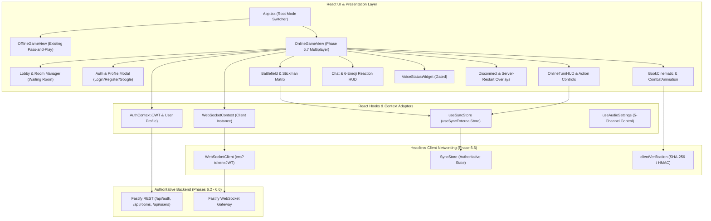
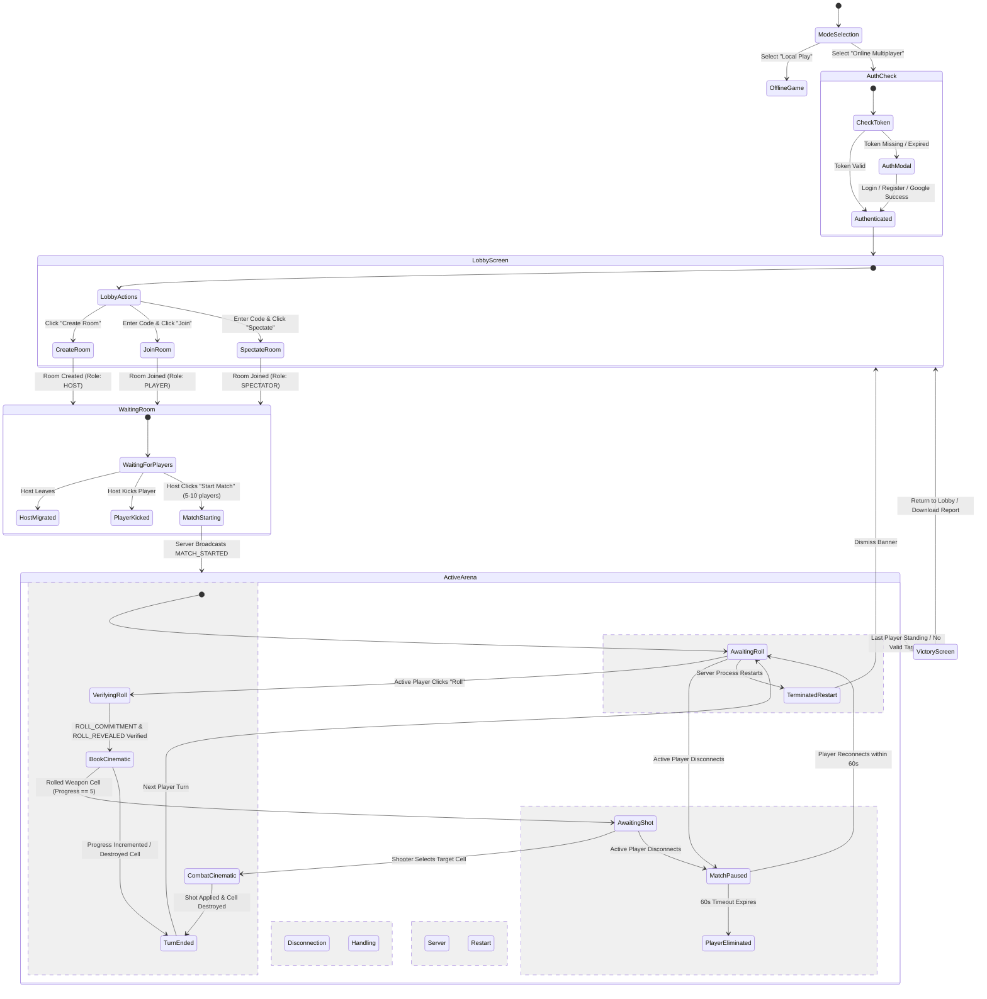
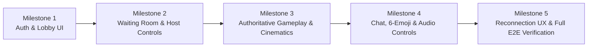

# PageShooter — Phase 6.7 Implementation Plan: Web Client Integration & UI

**Document Version:** 1.0.0  
**Phase Status:** PLANNING AUTHORIZED (READ-ONLY)  
**Author:** Antigravity (Google DeepMind pair programming assistant)  
**Authoritative Reference:** `docs/phase6_1_multiplayer_backend_architecture.md` (Frozen v3.2.0)  
**Execution Boundary:** Implementation Strictly Gated Pending User Approval  

---

## 1. Executive Summary

Phase 6.7 delivers the complete frontend integration of PageShooter's authoritative multiplayer backend into the browser web application. 

Phases 6.1 through 6.6 established and froze the backend architecture:
- Authoritative rules engine and cryptographic commitment-reveal (`@pageshooter/game-engine`, Phase 6.5)
- RAM-only room management, spectator isolation, and REST lifecycle (`apps/server`, Phase 6.4)
- Fastify WebSocket gateway on `/ws?token=<JWT>`, multi-tab supersession, disconnect/reconnect coordinator, and headless client transport (`apps/web/src/network`, Phase 6.6)
- Exact 6-emoji protocol whitelist compliance (`packages/shared`, Phase 6.6.1)

Phase 6.7 bridges the headless client networking (`WebSocketClient`, `SyncStore`, and `clientVerification`) with the interactive React UI, enabling seamless online multiplayer while preserving 100% of the existing offline pass-and-play experience.

### Key Objectives
1. **Mode Switch & Authentication UI:** Provide seamless switching between Offline Pass-and-Play and Online Multiplayer, with email/password and Google OAuth modal dialogs, token persistence in memory/sessionStorage, and 30-day username cooldown management.
2. **Multiplayer Room & Lobby UI:** Enable 6-character room creation, joining (as player or spectator), waiting-room seat assignment (5–10 players), host controls (kick, start match), and automatic host migration.
3. **Authoritative Gameplay Matrix:** Render live match state strictly from server updates via `SyncStore`. Bind player turn indicators, action locks, targeting overlays, and cell progression directly to validated server state.
4. **Verifiable Cinematic & Combat Presentation:** Synchronize the 4–6 second `BookCinematic` across all connected peers upon server commitment-reveal verification, alongside animated katana and projectile combat sequences, cell destruction, and victory screens.
5. **Match Recovery & Reconnection UX:** Display live 60-second pause countdowns during player disconnections, automatic reconnect re-sync via `RECONNECT_MATCH`, and unambiguous server-restart termination banners.
6. **Chat & 6-Emoji HUD:** Implement floating emoji cascades (strictly using `thumb`, `fire`, `skull`, `scream`, `sword`, `cheer`) and rate-limited room chat for players and spectators.
7. **5-Channel Audio & Dark Ancient Theme:** Expand `SoundManager` to independent volume and mute controls for Music, Book/Page, Combat, UI, and Voice, wrapped in an ancient magical dark-fantasy aesthetic.
8. **Separately Gated Voice Workstream:** Keep WebRTC voice chat strictly gated behind empirical Metered.ca TURN API verification, with fail-closed fallback to text/emoji communication to guarantee ₹0 expenditure.

---

## 2. Current Architecture and Repository Findings

### 2.1 Backend Readiness (`apps/server`)
- **Authentication & Users:** REST endpoints (`/api/auth/register-password`, `/api/auth/login-password`, `/api/auth/google`, `/api/auth/link-google`, `/api/users/me`, `/api/users/me/username`) are tested, rate-limited, and backed by a single PostgreSQL `users` table via Drizzle ORM.
- **Room Lifecycle:** `RoomManager` handles in-memory waiting rooms, 10-minute TTL expiry timers, 6-character Base-32 room codes, host migration, and spectator rosters.
- **WebSocket Gateway:** `/ws?token=<JWT>` authenticates clients during connection establishment, enforces 4 KB frame payload limits (close code 1009), redaction of tokens in server logs, and multi-tab supersession (close code 4409).
- **Match Coordination:** `ReconnectManager` coordinates 60-second independent disconnect timers, cancels pending mandatory shots (0 bullets retained), migrates host privileges during active matches, and detects server restarts via `serverInstanceId`.

### 2.2 Shared Protocol Readiness (`packages/shared`)
- **Schemas:** `wsSchemas.ts` defines complete Zod schemas and TypeScript types for all 12 client-to-server messages and 24 server-to-client messages.
- **Emoji Whitelist:** `ALLOWED_EMOJI_IDS` is locked to exactly `["thumb", "fire", "skull", "scream", "sword", "cheer"]`.
- **Game Engine Types:** Core game types (`MatchState`, `PlayerState`, `CellValue`, `MatchEvent`) are shared across backend and frontend.

### 2.3 Existing Frontend Client Network Layer (`apps/web/src/network`)
- **`WebSocketClient`:** Implements connection lifecycle, auto-reconnect backoff, message dispatch, typed convenience methods (`joinRoom`, `startMatch`, `roll`, `shoot`, `sendChat`, `sendEmoji`, `reconnectMatch`), and event listeners.
- **`SyncStore`:** Event-driven reactive store holding authoritative `room`, `match`, `serverInstanceId`, `activeCommitment`, `chatMessages`, and `verificationErrors`.
- **`clientVerification`:** Browser-native Web Crypto API implementation of SHA-256 commitment verification and HMAC-SHA256 roll outcome derivation.

### 2.4 Existing Frontend Game Presentation (`apps/web/src`)
- **`App.tsx`:** Single-page orchestrator currently hardwired to offline pass-and-play and QA harness modes (`?qa_view=...`).
- **`Battlefield.tsx` & `StickmanCell.tsx`:** Interactive SVG/HTML 5–10 seat circular/matrix arena rendering stickman progression stages (0–5).
- **`BookCinematic.tsx`:** 4–6 second animated book modal displaying flipping pages and outcome reveal.
- **`CombatAnimation.tsx`:** Hand-drawn cartoon katana dash, razor slash, blood splash, and knockout sequence.
- **`soundManager.ts`:** Web Audio API sound generator with master volume and mute controls.
- **`db.ts`:** IndexedDB persistence for offline matches (`folio_matches`).

---

## 3. Existing Components That Will Be Reused

Rather than reinventing existing UI and logic, Phase 6.7 will directly reuse and wrap established components:

| Component / Module | Path | Existing Role | Reuse Strategy in Phase 6.7 |
|---|---|---|---|
| `WebSocketClient` | `apps/web/src/network/websocketClient.ts` | Headless WebSocket connection manager | Primary network transport for online mode. Bound to React via context hook. |
| `SyncStore` | `apps/web/src/network/syncStore.ts` | In-memory authoritative state store | Core state store for online rooms and matches. React subscribes via `useSyncExternalStore`. |
| `assertRollCommitmentValid` | `apps/web/src/network/clientVerification.ts` | Web Crypto verification | Validates `ROLL_REVEALED` outcomes before triggering cinematic animations. |
| `Battlefield` | `apps/web/src/components/Battlefield.tsx` | 5–10 player game matrix | Reused directly; fed authoritative `matchState` from `SyncStore`. Targeting clicks emit `shoot()` commands. |
| `StickmanCell` | `apps/web/src/components/StickmanCell.tsx` | Hand-drawn stickman cell renderer | Reused directly; displays authoritative cell progression (0–5) and destroyed states. |
| `BookCinematic` | `apps/web/src/components/BookCinematic.tsx` | 4–6s book rolling animation | Reused directly; triggered when authoritative roll outcome and seed verification succeed. |
| `CombatAnimation` | `apps/web/src/components/CombatAnimation.tsx` | Multi-phase combat animation | Reused directly; triggered upon receiving shot/elimination events from the server. |
| `EliminationModal` | `apps/web/src/components/EliminationModal.tsx` | Player elimination notification | Reused directly; triggered when any player's `status` becomes `ELIMINATED`. |
| `VictoryModal` | `apps/web/src/components/VictoryModal.tsx` | Match victory celebration | Reused directly; displays winner and match summary on `MATCH_COMPLETED`. |
| `SoundManager` | `apps/web/src/audio/soundManager.ts` | Synthetic Web Audio sound effects | Extended to support 5 distinct channel volume/mute controls. |
| `characterRegistry` | `apps/web/src/characters/registry.ts` | 10 character assets & configs | Reused directly for avatar selection and seat character binding. |
| `IndexedDB` (`db.ts`) | `apps/web/src/storage/db.ts` | Offline match autosave | Strictly preserved for Offline Pass-and-Play mode. Untouched by online mode. |

---

## 4. Proposed Frontend Architecture

### 4.1 Layered Frontend Structure



### 4.2 State Flow Principles
1. **Unidirectional Server Authority:** The browser never calculates game state changes locally for online matches. User interactions (clicking Roll or targeting a cell) call `wsClient.roll()` or `wsClient.shoot()`. The server processes the command and broadcasts `MATCH_STATE_SYNC` or event messages.
2. **Deterministic UI Derivation:** `SyncStore` processes incoming WebSocket frames, updates its internal state immutably, and calls subscribers. React components re-render via `useSyncExternalStore`.
3. **Optimistic Rendering Prohibited:** Actions are never optimistically applied. Action buttons enter a pending state until server confirmation (`ACK`, `ROLL_COMMITMENT`, or `MATCH_STATE_SYNC`) arrives.
4. **Complete Offline Isolation:** Offline state is managed exclusively by `@pageshooter/game-engine` and persisted to IndexedDB. Online state is managed exclusively by `SyncStore` and held in RAM. Neither subsystem shares state or storage.

---

## 5. Component Hierarchy

```text
App (Mode Selector: OFFLINE | ONLINE)
├── NavigationBar (Mode Toggle, Auth Button, Sound Settings Toggle)
├── AudioSettingsModal (5 Channel Volume Sliders & Mute Toggles)
├── [Mode == OFFLINE]
│   └── SetupScreen / Battlefield / BookCinematic / CombatAnimation / VictoryModal
└── [Mode == ONLINE]
    ├── AuthModal (Login, Register, Google OAuth, Profile Management)
    ├── [RoomState == null]
    │   └── MultiplayerLobbyScreen (Create Room, Join by Code, Spectate by Code)
    ├── [RoomState.phase == "WAITING"]
    │   └── WaitingRoomScreen
    │       ├── RoomHeader (Code, Copy Button, Player Count 5-10)
    │       ├── PlayerGrid (Seats, Avatars, Host Crown, Kick Buttons)
    │       ├── SpectatorList (Drawer/Badge showing up to 5 spectators)
    │       ├── HostControls (Start Match button, Minimum 5 players indicator)
    │       └── RoomChatDrawer (Text Chat & Emojis)
    ├── [RoomState.phase in "ACTIVE" | "PAUSED" | "COMPLETED"]
    │   └── MultiplayerArenaScreen
    │       ├── OnlineTurnHUD (Current Player, Turn Phase, Roll Button, Spectator Badge)
    │       ├── Battlefield (Authoritative 5-10 seat matrix, Targeting overlay)
    │       ├── EventFeed (Authoritative combat log)
    │       ├── BookCinematic (4-6s verifiable roll animation)
    │       ├── CombatAnimation (Cartoon katana/projectile sequence)
    │       ├── EliminationModal (Player elimination notice)
    │       ├── VictoryModal (Match completed celebration & report download)
    │       ├── ChatAndEmojiHUD (Floating emoji reactions & room text chat)
    │       ├── DisconnectOverlay (60s pause countdown banner)
    │       ├── ServerRestartOverlay (Match terminated restart banner)
    │       └── VoiceChatWidget (Gated STUN/TURN status & Push-to-Talk)
```

---

## 6. Page and Screen Flow



---

## 7. State Management and Synchronization Strategy

### 7.1 Reactive Subscription with `useSyncExternalStore`
To guarantee tearing-free, performant rendering in React 18/19, `SyncStore` is integrated directly using React's `useSyncExternalStore`:

```typescript
// Proposed hook: apps/web/src/network/useSyncStore.ts
export function useSyncStore(): Readonly<SyncStoreState> {
  const { syncStore } = useWebSocket();
  return useSyncExternalStore(
    (callback) => syncStore.subscribe(callback),
    () => syncStore.getState(),
    () => syncStore.getState()
  );
}
```

### 7.2 Derived Selectors
Components will consume memoized selectors to prevent redundant re-renders:
- `selectIsCurrentTurn(state, currentUserId)`: Returns `boolean` whether local user owns the active turn.
- `selectCanRoll(state, currentUserId)`: True if `turn.phase === "AWAITING_ROLL"`, user is current player, and not a spectator.
- `selectCanShoot(state, currentUserId)`: True if `turn.phase === "AWAITING_SHOT"`, user is current player, and not a spectator.
- `selectValidTargets(state, currentUserId)`: Returns list of `{ playerId, cellValue }` tuples that are legal targets under game engine rules.
- `selectIsSpectator(state, currentUserId)`: True if local user is in `room.spectators`.

---

## 8. WebSocket Event-to-UI Mapping

| Server WebSocket Message | `SyncStore` Action | UI Reaction |
|---|---|---|
| `AUTH_SUCCESS` | Sets connection state | Dismisses connecting spinner; enables lobby/room actions |
| `ROOM_SNAPSHOT` | `applyRoomSnapshot()` | Populates waiting room or active arena; sets `serverInstanceId` |
| `PLAYER_JOINED` | `applyPlayerJoined()` | Updates waiting room seat grid; plays subtle join chime |
| `PLAYER_LEFT` | `applyPlayerLeft()` | Removes player from seat grid; plays leave chime |
| `PLAYER_KICKED` | `applyPlayerLeft()` | If local user kicked, displays kick notification and returns to lobby |
| `SPECTATOR_JOINED` | `applySpectatorJoined()` | Increments spectator badge count; updates spectator drawer |
| `SPECTATOR_LEFT` | `applySpectatorLeft()` | Decrements spectator badge count |
| `HOST_MIGRATED` | `applyHostMigrated()` | Updates host crown icon; enables host controls if local user is new host |
| `MATCH_STARTED` | `applyMatchStarted()` | Transitions view from Waiting Room to `MultiplayerArenaScreen` |
| `ROLL_COMMITMENT` | `applyCommitment()` | Displays "Opening Storybook Folio..." status in Turn HUD |
| `ROLL_REVEALED` | `applyRollRevealed()` | Verifies SHA-256/HMAC seed via Web Crypto; launches `BookCinematic` |
| `MATCH_STATE_SYNC` | `applyMatchStateSync()` | Synchronizes authoritative player matrix, cells, and progression |
| `MATCH_PAUSED` | `applyMatchPaused()` | Displays 60s countdown banner with disconnected player's username |
| `MATCH_RESUMED` | `applyMatchResumed()` | Dismisses 60s countdown banner; resumes active turn indicator |
| `PLAYER_ELIMINATED` | `applyPlayerEliminated()` | Marks seat as eliminated; triggers `EliminationModal` |
| `MATCH_COMPLETED` | `applyMatchCompleted()` | Launches `VictoryModal` with winner details and report download |
| `MATCH_TERMINATED_SERVER_RESTART` | `applyMatchTerminated()` | Displays full-screen modal: *"Server Restarted — Active Match Terminated"* |
| `CHAT_BROADCAST` | `applyChatBroadcast()` | Appends chat bubble to in-game chat drawer; plays soft notification |
| `EMOJI_BROADCAST` | (Dispatched to UI) | Spawns floating animated emoji sprite over sender's battlefield seat |
| `ERROR` | (Emits UI Toast) | Displays non-blocking error toast (e.g., *"Not your turn"*, *"Muted"*) |

---

## 9. Authentication and Session Handling

### 9.1 Authentication Modalities
1. **Username/Password:**
   - Registration: `POST /api/auth/register-password` (Username, Password, Avatar ID).
   - Login: `POST /api/auth/login-password` (Username, Password).
2. **Google OAuth 2.0:**
   - One-tap / Google Sign-In button generating Google ID token.
   - Login/Register: `POST /api/auth/google` (Google ID token).
   - Account Linking: `POST /api/auth/link-google` (authenticated user links Google identity).
3. **Guest / Offline Mode:**
   - No authentication required. Fully isolated local pass-and-play.

### 9.2 Token Storage & Hygiene
- **Storage:** Access tokens (7-day JWT) are held in React state and mirrored in `sessionStorage` for page-refresh survival. Tokens are **never** written to `localStorage` or persistent storage.
- **WebSocket Handshake:** Passed via `/ws?token=<JWT>`. Infrastructure and Fastify request logging redact `token=[REDACTED]`.
- **Session Expiry:** If the server returns close code `4401` (`UNAUTHORIZED`), the client clears `sessionStorage`, disconnects the socket, and presents the authentication modal.

### 9.3 User Profile Management
- Displays current username, account creation date, and linked Google status via `GET /api/users/me`.
- Username changes (`PATCH /api/users/me/username`):
  - Enforces the 30-day cooldown period.
  - UI displays countdown (e.g., *"Username can be changed in 18 days"*).

---

## 10. Multiplayer Lobby Implementation Plan

### 10.1 Create & Join Room Flows
- **Create Room:** Host clicks "Create Room", selects preferred avatar, and sends `POST /api/rooms`. On response `201`, client initializes `WebSocketClient`, connects to `/ws?token=<JWT>`, and sends `JOIN_ROOM`.
- **Join Room:** Player inputs 6-character room code (sanitized to uppercase alphanumeric, Base-32 vowels omitted per Section 7 of architecture). Clicks "Join as Player" or "Join as Spectator".
- **Invalid Room Handling:** If room code does not exist or has expired (10-minute TTL), displays inline error: *"Room not found or expired"*.

### 10.2 Waiting Room Screen
- **Capacity:** Enforces 5 to 10 players. "Start Match" button is disabled until at least 5 players have joined.
- **Host Controls:**
  - Distinct golden crown icon next to host's username.
  - Kick button (`KICK_PLAYER`) next to each non-host player.
  - "Start Match" button (`START_MATCH`) enabled only for host when $5 \le \text{playerCount} \le 10$.
- **Host Migration in Waiting Room:** If the host disconnects or leaves, the earliest-joined player (`joinSequence`) is promoted to host immediately. The UI re-renders host badges and controls without room recreation.
- **Spectator List:** Displays a collapsible drawer listing all connected spectators with eye icons.

---

## 11. Gameplay UI Implementation Plan

### 11.1 Authoritative Matrix Arena
- **Seat Mapping:** Dynamically positions 5–10 seats around the arena based on the server's shuffled positions ($P_1 \dots P_n$).
- **Cell Rendering:** Each seat contains 5 cells (values `0, 2, 4, 6, 8`). Each cell renders:
  - Progress bar (0–5 tick marks).
  - Hand-drawn stickman body parts corresponding to progress (0: Blank, 1: Face, 2: Torso, 3: Legs, 4: Arms, 5: Folio Weapon).
  - Destroyed state: Red cross / slashed parchment effect when `cell.destroyed === true`.
- **Status Indicators:**
  - Active turn halo / golden quill highlight around the current player's seat.
  - Disconnected badge with remaining countdown if player's socket drops.
  - "Eliminated" gravestone / ghost badge for eliminated players.

### 11.2 Turn HUD & Action Flow
- **Phase: `AWAITING_ROLL`:**
  - Current Player: "Roll Storybook" button glows with pulsating ancient rune effect.
  - Opponents / Spectators: Status reads *"Waiting for [Player Name] to roll..."*.
- **Phase: `AWAITING_SHOT`:**
  - Current Player: "Select Target Cell" banner appears. Valid opponent cells become clickable with targeting reticles. Invalid cells (already destroyed or own cells) are dimmed with a prohibited icon.
  - Opponents / Spectators: Status reads *"[Player Name] is aiming weapon..."*.

---

## 12. Animation and Audio Integration

### 12.1 Verifiable Book Cinematic (`BookCinematic.tsx`)
- Duration: 4–6 seconds (meets frozen architecture requirement).
- Simultaneous Trigger: When `ROLL_REVEALED` arrives, all clients verify the cryptographic hash commitment locally:
  $$\text{assertRollCommitmentValid}(\text{seed}, \text{matchId}, \text{turnNumber}, \text{hash}, \text{outcome}, \text{page})$$
- Animation sequence:
  1. Book cover opens with mystical glowing parchment particles (0.8s).
  2. Pages flip rapidly with realistic synthetic paper rustle audio (2.5s).
  3. Land on exact page number with bold calligraphy and revealed outcome cell (1.5s).
- Cryptographic Fault Handling: If verification fails, the cinematic aborts, and a high-priority red alert banner is rendered: *"Cryptographic Verification Failed — Outcome Tampering Detected"*.

### 12.2 Combat Sequences (`CombatAnimation.tsx`)
- When a valid shot is broadcast via `MATCH_STATE_SYNC` with shot events:
  1. **Focus:** Zoom in on shooter and target (0.5s).
  2. **Katana Dash / Aim:** Character draws weapon and dashes across battlefield (0.8s).
  3. **Razor Slash / Impact:** Full-screen stylized slash with particle explosion (0.6s).
  4. **Cell Destruction:** Target cell shatters with synthetic impact audio (0.6s).
  5. If shot resulted in elimination, transitions smoothly into `EliminationModal`.

### 12.3 5-Channel Audio System (`soundManager.ts`)
Upgrade `SoundManager` from a single volume control to 5 independent channels:
1. **Master / Music:** Background ambience and theme music.
2. **Book / Page:** Storybook opening chime, page flips, and outcome reveal bells.
3. **Combat:** Gunshots, katana slashes, cell shatter, and elimination gongs.
4. **UI:** Button clicks, turn notifications, chat pings, and emoji pops.
5. **Voice:** WebRTC incoming voice audio volume.

Each channel provides:
- Volume slider ($0.0 \dots 1.0$)
- Mute toggle (`boolean`)
- Persistence in `localStorage` (`pageshooter_audio_v2_settings`)

---

## 13. Chat and Emoji Implementation

### 13.1 Floating Emoji Reactions
- **Strict Whitelist (6 IDs):**
  1. `thumb` (👍)
  2. `fire` (🔥)
  3. `skull` (💀)
  4. `scream` (😱)
  5. `sword` (⚔️)
  6. `cheer` (🎉)
- **UI Interaction:** Floating action bar docked at the bottom of the arena. Clicking an emoji emits `SEND_EMOJI_REACTION`.
- **Ephemeral Animation:** Upon receiving `EMOJI_BROADCAST`, an animated SVG emoji rises from the sender's seat, bobs upward over 1.8 seconds, and fades out.
- **Rate-Limiting Protection:** UI disables the emoji button for 500ms after clicking to guide user behavior. If excess emojis are clicked, the server silently drops them without UI penalty.

### 13.2 Room Text Chat Drawer
- Slide-out side drawer accessible to all active players and spectators.
- Character limit: 200 characters enforced client-side (`maxlength="200"`) and server-side.
- Cooldown UI: If user sends faster than 1 message per 2 seconds, UI displays a 30-second mute countdown timer based on server `MUTED` error response.
- Chat does not obscure the central battlefield arena.

---

## 14. Reconnection and Error-State UX

### 14.1 60-Second Disconnect Pause Banner
- When another player disconnects, server broadcasts `MATCH_PAUSED` with `deadline: number`.
- UI renders a non-dismissible top banner:
  > **Match Paused:** *[Player Name]* disconnected. Waiting for reconnection: **[MM:SS]**
- If player reconnects within the window, server sends `MATCH_RESUMED`, and the banner dissolves with a green *"Player Reconnected"* toast.
- If timeout expires, server sends `PLAYER_ELIMINATED`, and match resumes with the remaining players.

### 14.2 Local Client Disconnection & Reconnection
- If the local user's WebSocket closes unexpectedly:
  1. `WebSocketClient` automatically initiates exponential backoff reconnects (1s, 2s, 4s, up to 10s).
  2. UI displays a sticky reconnecting modal: *"Connection lost. Reconnecting to match..."*.
  3. Upon socket re-opening, client sends `RECONNECT_MATCH` with `lastKnownVersion` and `serverInstanceId`.
  4. Server responds with `ROOM_SNAPSHOT` and latest `MatchState`. UI re-syncs state immediately and dismisses the modal.

### 14.3 Server Restart Termination Screen
- If the server restarts during an active match, RAM state is erased, and a new `serverInstanceId` is generated.
- When client reconnects, the server detects the instance mismatch or missing room and sends `MATCH_TERMINATED_SERVER_RESTART`.
- UI renders an unambiguous modal:
  > **Match Terminated (Server Restart):** The server process restarted. Because active games are kept strictly in RAM to protect privacy and zero-cost hosting, this match has ended.
  > `[ Return to Lobby ]`

---

## 15. Responsive Design and PWA Strategy

### 15.1 Responsive Layout Breakpoints
- **Mobile (< 640px):**
  - Compact vertical stack.
  - Battlefield arranges seats in a responsive 2-column or carousel layout.
  - Chat and emoji controls placed in a swipeable bottom sheet.
  - Turn HUD pinned to the top header.
- **Tablet (640px – 1024px):**
  - Circular arena view with docked side chat drawer.
- **Desktop (> 1024px):**
  - Expansive dark-fantasy book arena.
  - Permanent right-hand sidebar for chat and spectator roster.

### 15.2 PWA & Dark Fantasy Visual Theme
- **Theme Palette:**
  - Background: Deep obsidian parchment (`#0f0d13`) with subtle leather/parchment grain texture.
  - Card/Cell Backgrounds: Weathered ancient vellum (`#1e1a24`).
  - Highlights: Mystical cyan runes (`#22d3ee`), amber alchemy accents (`#f59e0b`), crimson blood slashes (`#ef4444`).
  - Typography: Hand-drawn handwritten font (Fredoka / Cinzel) for authentic storybook feel.
- **PWA Manifest:**
  - Standalone display mode (`"display": "standalone"`).
  - Service worker caching for application shell, stickman SVG assets, and audio soundbanks.
  - Offline mode functions 100% when no network is available.

---

## 16. Voice Integration as a Separate Gated Workstream

### 16.1 Strict Architectural Prerequisites (ADR-03 & Section 9.4)
Voice chat is **NOT** bundled into the core Phase 6.7 UI delivery. It is planned as a separately gated workstream that requires explicit empirical verification before any WebRTC code is activated.

### 16.2 Metered.ca TURN Empirical Validation Checklist
Before voice relay can be authorized:
1. **API Endpoint Verification:** Empirically verify Metered.ca's Management API (`GET /api/v1/reports/usage` or credentials usage endpoint) using backend test requests.
2. **Reporting Delay Measurement:** Measure latency between TURN byte relay and provider usage counter increment.
3. **Usage Accuracy:** Verify `totalBandwidthBytes` accurately tracks multi-peer audio data.
4. **Credential TTL:** Confirm short-lived TURN credentials expire reliably (e.g., 15 minutes).
5. **Automated Shutdown Test:** Verify backend shuts down TURN issuance at 85% of monthly free quota.

### 16.3 Hard Fail-Closed Requirement
If Metered.ca API telemetry cannot be proven 100% reliable or exhibits unpredictable reporting delays:
- **TURN Relay Remains Permanently Disabled.**
- Voice chat will either operate exclusively via Google Public STUN (`stun:stun.l.google.com:19302`) on direct P2P connections, or voice will remain completely disabled.
- In-game text chat and the 6 authorized emoji reactions serve as the permanent, zero-cost communication channels.
- **No credit card or payment method will ever be attached.**

---

## 17. Security Threat Analysis and Mitigations

| Threat Vector | Potential Impact | Phase 6.7 Mitigation |
|---|---|---|
| **Client-Side Action Spoofing** | Rogue client attempts to roll out of turn or shoot invalid targets | Server validates all commands against authoritative `MatchState`. Client UI disabling is cosmetic; server strictly returns `403 NOT_YOUR_TURN` or `400 INVALID_TARGET`. |
| **Spectator Action Injection** | Spectator tries to send `ROLL_REQUEST` or `SHOOT_REQUEST` | Server checks `room.players.has(userId)`. Non-players are rejected immediately. |
| **Commitment-Reveal Tampering** | Manipulated roll outcome delivered to client | Client executes Web Crypto SHA-256 verification of seed and HMAC outcome before rendering. Mismatches trigger a fatal verification error. |
| **Credential Leakage in Logs** | JWT exposed in browser history or server access logs | Fastify serializer redacts `token=[REDACTED]`. Referrer-Policy header is `no-referrer`. Tokens are held in `sessionStorage` and never printed in logs. |
| **Chat / Emoji Spamming** | Malicious participant floods room with messages | Server rate limits enforced: Chat (1 per 2s, 30s mute), Emoji (max 2 per second, excess silently dropped). UI enforces input disabling. |
| **Multi-Tab Phantom Disconnects** | User opens second tab, causing older socket disconnect to ruin active match | Server implements atomic session supersession (close code 4409). Older tab displays *"Session opened in another window"*; active match is unaffected. |
| **Cross-Site Scripting (XSS)** | Malicious chat message executes scripts | All chat messages rendered as sanitized text nodes in React; no `dangerouslySetInnerHTML`. Length limited to 200 chars. |

---

## 18. Testing Strategy

### 18.1 Unit & Component Tests (`apps/web/test`)
- **`useSyncStore.test.ts`:** Tests store subscription, selector memoization, and reaction to `applyMatchStateSync`, `applyMatchPaused`, etc.
- **`OnlineTurnHUD.test.tsx`:** Verifies roll button enable/disable states based on user ID and turn phase.
- **`BattlefieldTargeting.test.tsx`:** Verifies targeting reticles appear only on valid opponent cells during `AWAITING_SHOT`.
- **`EmojiReactionHUD.test.tsx`:** Tests rendering of exactly 6 authorized emoji buttons and emission of `SEND_EMOJI_REACTION`.
- **`SoundManagerChannels.test.ts`:** Verifies independent volume and mute controls for all 5 audio channels.

### 18.2 Integration Tests (`apps/web/test/integration`)
- **`multiplayerLobbyFlow.test.tsx`:** Simulates Room Creation -> Waiting Room -> Host Start -> Arena Transition using mocked WebSocket server.
- **`reconnectRecoveryFlow.test.tsx`:** Simulates socket drop -> 60s pause countdown -> `RECONNECT_MATCH` -> state restoration.
- **`spectatorExperience.test.tsx`:** Verifies spectators see live match updates but have no interactive action triggers.

### 18.3 Verification Quality Gates
All proposed additions must pass the established 4 quality gates:
1. `npm.cmd test` (100% tests passing across all packages)
2. `npm.cmd run typecheck` (0 TypeScript errors)
3. `npm.cmd run lint` (0 ESLint errors/warnings)
4. `npm.cmd run build` (Clean production builds of web bundle and server dist)

---

## 19. Performance and Accessibility Considerations

### 19.1 Performance
- **Zero DOM Churn:** Matrix cells only re-render when their specific progress, weapon, or destroyed status changes.
- **Lightweight SVG Sprites:** All stickman illustrations and icons use lightweight inline SVG or CSS canvas, keeping the entire web bundle under 450 kB gzipped.
- **Animation Decoupling:** CSS transforms (`translate3d`, `opacity`) are used for book flipping and emoji cascades to ensure 60 FPS on mobile GPUs.

### 19.2 Accessibility (a11y)
- **Keyboard Navigation:** All interactive cells, buttons, and chat inputs are accessible via `Tab` and `Enter`/`Space`.
- **Screen Reader Announcements:** ARIA live regions announce turn changes (e.g., *"It is now Barnaby's turn"*), roll outcomes, and combat results.
- **Color Contrast:** All dark parchment text maintains a minimum contrast ratio of 4.5:1 against vellum backgrounds.
- **Motion Reduction:** Respects `prefers-reduced-motion` media queries by shortening or skipping cinematics for sensitive users.

---

## 20. File-by-File Proposed Changes

### A. New Frontend Files (`apps/web/src`)
1. `apps/web/src/context/AuthContext.tsx`: React context for JWT, user profile, login, registration, and logout.
2. `apps/web/src/context/WebSocketContext.tsx`: React context managing `WebSocketClient` lifecycle and reconnection.
3. `apps/web/src/network/useSyncStore.ts`: Custom hook exposing `SyncStore` state via `useSyncExternalStore`.
4. `apps/web/src/components/online/OnlineGameView.tsx`: Top-level orchestrator for online multiplayer flow.
5. `apps/web/src/components/online/AuthModal.tsx`: Modal for password auth, Google OAuth, and profile management.
6. `apps/web/src/components/online/MultiplayerLobbyScreen.tsx`: Screen for creating, joining, and spectating rooms.
7. `apps/web/src/components/online/WaitingRoomScreen.tsx`: Waiting room UI with 5–10 seat grid, host controls, and spectator list.
8. `apps/web/src/components/online/OnlineTurnHUD.tsx`: Authoritative Turn HUD with roll button, phase indicators, and spectator badge.
9. `apps/web/src/components/online/ChatAndEmojiHUD.tsx`: Docked floating emoji bar and slide-out room chat drawer.
10. `apps/web/src/components/online/DisconnectOverlay.tsx`: 60-second match pause countdown banner.
11. `apps/web/src/components/online/ServerRestartModal.tsx`: Notice modal when server restart erases in-memory match state.
12. `apps/web/src/components/online/AudioSettingsModal.tsx`: 5-channel volume and mute controls.

### B. Modified Frontend Files (`apps/web/src`)
1. `apps/web/src/App.tsx`: Add navigation bar and mode toggle between Offline Pass-and-Play and Online Multiplayer.
2. `apps/web/src/audio/soundManager.ts`: Upgrade `SoundManager` to support 5 distinct audio channels with individual volume/mute.
3. `apps/web/src/components/Battlefield.tsx`: Accept optional targeting callback and spectator mode flag for online play.

### C. Modified Backend Files (`apps/server/src`)
*None required for core Phase 6.7 UI.* The backend is frozen and fully implements all necessary REST and WebSocket protocols.

---

## 21. Dependencies and Prerequisites

### 21.1 Proposed Runtime Dependencies
- **No new runtime dependencies required.**
  - React, Vite, Tailwind CSS, Lucide icons, and Web Audio API are already installed in `apps/web`.
  - Fastify, `@fastify/websocket`, Zod, and Drizzle ORM are already installed in `apps/server`.
  - TypeScript, Vitest, and ESLint are already configured across the monorepo.
  - Web Crypto API is native in all modern browsers.

### 21.2 Zero-Cost Assessment
- All components execute client-side or on existing free-tier services.
- **Cost Impact:** Exactly ₹0.

---

## 22. Risks and Unresolved Decisions

| Risk / Gray Area | Impact | Planned Resolution / Strategy |
|---|---|---|
| **Render Free Tier Cold Start** | Initial connection takes 30–50s if backend was spun down | UI displays an informative ancient waiting message: *"Summoning game server from its slumber (cold start)..."* with progress spinner. |
| **Mobile Screen Real Estate** | 10-player matrix cramped on mobile portrait screens | Mobile layout uses a responsive 2-column seat view with horizontal swipe for opponent seats during targeting. |
| **Simultaneous Book Animation Timing** | Slight network jitter causes cinematic to start 100–300ms apart | `ROLL_COMMITMENT` pre-caches animation assets; `ROLL_REVEALED` starts cinematic locally immediately upon verification. Game state is already committed. |
| **Metered.ca TURN Quota Reliability** | Relayed bandwidth reporting delay could exceed shutdown window | **GATED:** Voice relay remains permanently disabled unless Metered.ca API verification proves reporting latency is under 5 minutes. |

---

## 23. Ordered Implementation Milestones

To maintain rigorous quality control, Phase 6.7 will be executed across 5 sequential milestones upon authorization:



### Milestone 1: Authentication & Multiplayer Lobby UI
- Implement `AuthContext`, `AuthModal`, and `MultiplayerLobbyScreen`.
- Connect REST endpoints for Login, Register, Google OAuth, and Room Creation.
- Add mode switch in `App.tsx` (Offline Pass-and-Play vs Online Multiplayer).
- *Acceptance Criteria:* User can register/login, create a room, view room code, or join an existing room by 6-char code. Offline mode remains completely functional.

### Milestone 2: Waiting Room & Host Controls
- Implement `WaitingRoomScreen` with 5–10 seat grid, avatar display, and spectator list.
- Implement host kick functionality and waiting-room host migration.
- Implement "Start Match" button gating (disabled until 5 players join).
- *Acceptance Criteria:* 5 players can join a waiting room, host can kick players, host leaving migrates crown to next player, and host can launch match.

### Milestone 3: Authoritative Gameplay & Verifiable Cinematics
- Implement `useSyncStore` hook and `OnlineTurnHUD`.
- Integrate `Battlefield` with authoritative `SyncStore` state.
- Wire Web Crypto commitment-reveal verification to `BookCinematic` (4–6s).
- Wire shot events to `CombatAnimation`, cell destruction, and `EliminationModal`.
- Wire `VictoryModal` to `MATCH_COMPLETED`.
- *Acceptance Criteria:* Players take turns rolling and shooting. Only authorized active player can act. Spectators view read-only updates. Cryptographic verification passes on every roll.

### Milestone 4: Chat, 6-Emoji HUD & 5-Channel Audio
- Implement `ChatAndEmojiHUD` with the 6 authorized emoji IDs (`thumb`, `fire`, `skull`, `scream`, `sword`, `cheer`).
- Implement ephemeral rising emoji animations and rate-limit handling.
- Upgrade `SoundManager` to 5 independent channels with `AudioSettingsModal`.
- *Acceptance Criteria:* Chat messages broadcast within 200-char limit; mute timer triggers on spam; all 6 emojis animate correctly; all 5 audio channels can be independently muted/adjusted.

### Milestone 5: Reconnection UX & Full E2E Integration
- Implement `DisconnectOverlay` with 60-second countdown for disconnected peers.
- Implement automatic client reconnect and `RECONNECT_MATCH` re-sync.
- Implement `ServerRestartModal` for in-memory instance reset detection.
- Execute full test suite, typecheck, lint, and production builds.
- *Acceptance Criteria:* Disconnecting a tab pauses match with 60s countdown; reconnecting restores exact match state; server restart displays termination banner; all 4 quality gates pass.

---

## 24. Explicit Confirmation of ₹0 Constraint Preservation

I explicitly confirm that Phase 6.7 adheres strictly to the ₹0 hosting and operational budget:
- **No Paid Dependencies:** No third-party paid libraries, commercial game engines, or paid UI kits are introduced.
- **No Cloud Resources Provisioned:** All code runs inside the browser client and existing free-tier services (Render Free, Supabase Free, Cloudflare/Firebase Hosting Free).
- **No Uptime Pingers:** No external keep-alive bots or synthetic pingers are introduced; cold starts are embraced and communicated transparently to users.
- **Fail-Closed Voice Relay:** Metered.ca TURN relay is strictly gated and will remain disabled if zero-cost quota safety cannot be proven. Under no circumstances will a payment card or billing account be linked.
- **Absolute Budget Guarantee:** Total recurring financial cost of Phase 6.7 is **₹0.00**.
