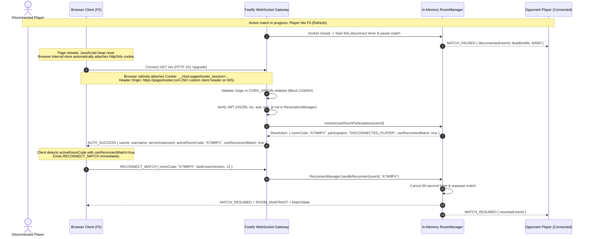

# PageShooter — Milestone 1.1 Session Recovery & Authentication Design (v2.3.0)

**Document Version:** 2.3.0  
**Status:** PROPOSED ARCHITECTURAL RECONCILIATION (READ-ONLY INVESTIGATION)  
**Author:** Antigravity (Google DeepMind pair programming assistant)  
**Authoritative Reference:** `docs/phase6_1_multiplayer_backend_architecture.md` (Frozen v3.2.0)  
**Scope Boundary:** Read-Only Investigation — No Application Code, Schemas, or Dependencies Modified  

---

## Executive Summary

This document specifies the **Zero-Token Client & Session Recovery Architecture** for PageShooter (Phase 6.7 Milestone 1.1). It resolves the conflict between storing tokens purely in React memory (which broke on F5 refresh) and exposing tokens to browser Web Storage (which exposed them to XSS theft).

The v2.3.0 revision establishes complete, production-grade specifications for:
1. **Accurate Transport Constraints:** Native browser WebSockets authenticate via the `__Host-pageshooter_session` cookie and validate `Origin`. Custom headers (`X-PageShooter-Client: web`) are enforced strictly on state-changing REST routes.
2. **Fail-Closed Revocation Manager:** Unexpired revocation entries are never evicted. At maximum capacity (10,000 entries), new logouts fail closed with HTTP 503 rather than permitting unrecorded logouts.
3. **Single Recoverable Room Invariant:** A user can have only one active room association. The 6-state lookup enforces strict role precedence, with a stable lexicographical `roomId` tie-breaker ensuring spectators and completed participants never supersede active players.
4. **Precise Credential Wording:** Eliminates misleading "zero credential in browser" phrasing. No JWT is exposed to JavaScript-accessible storage or application memory; the browser's internal cookie store retains the `HttpOnly` cookie and automatically attaches it to eligible requests.
5. **In-Flight Authorization Boundaries & Logout-Race Verification:** Mandates pre-commit revocation checks in mutating handlers and specifies a dedicated test suite with deliberate asynchronous pauses to verify in-flight operation rejection upon concurrent logout.

---

## 1. Architectural Topology & Sequence Flows

```
                                  +-------------------------------------------------------+
                                  |                 Fastify Game Backend                  |
                                  |                                                       |
[ Browser Client ]                |  +--------------------+      +---------------------+  |
(Zero JWT in JS)                  |  |  @fastify/cookie   |      | RevocationManager   |  |
                                  |  |  (Cookie Parsing)  |      | (Bounded RAM TTL    |  |
+--------------------------+      |  +---------+----------+      |  Fail-Closed Map)   |  |
| React Auth Context       |      |            |                 +----------+----------+  |
| user: PublicUserProfile  |      |            v                            |             |
| (No JWT in JS memory)    |      |  +-------------------------------------------------+  |
+------------+-------------+      |  | Auth Middleware & WS Gateway Handshake          |  |
             |                    |  | - Verify Pinned HS256 JWT (iss, aud, exp, sub)  |  |
             |                    |  | - Consult RevocationManager (jti check)         |  |
             |                    |  | - REST: Enforce Strict Origin & Custom Header   |  |
             | REST with Cookie   |  | - WS: Enforce Strict Origin Only (No header)   |  |
             +------------------->|  +------------------------+------------------------+  |
             | (credentials:      |                           |                           |
             |   "include",       |                           v                           |
             |   X-PageShooter-   |  +-------------------------------------------------+  |
             |   Client: web)     |  | Authoritative RAM Room Manager                  |  |
             |                    |  | - resolveUserRoomParticipation(userId)          |  |
             | WS with Cookie     |  |   (Deterministic 6-State Resolution)            |  |
             +------------------->|  | - 60s Reconnect & Host Migration Timers         |  |
               (Browser Auto-     |  +-------------------------------------------------+  |
                attaches Cookie)  +-------------------------------------------------------+
```

### 1.1 Authentication & Registration Flow
```mermaid
sequenceDiagram
    autonumber
    actor User as User / Player
    participant UI as React Client (AuthContext)
    participant Server as Fastify Server
    participant DB as PostgreSQL (Single users table)

    User->>UI: Submit Login / Register credentials
    UI->>Server: POST /api/auth/login-password (credentials: "include", Header: X-PageShooter-Client: web)
    Server->>Server: Validate Origin == CORS_ORIGIN & Header X-PageShooter-Client == web
    Server->>DB: Query user & verify Argon2id password
    DB-->>Server: User record valid
    Server->>Server: Generate HS256 JWT { jti, sub: userId, username, iss, aud, exp (24h) }
    Note over Server,UI: Set-Cookie: __Host-pageshooter_session=<jwt>; Path=/; Secure; HttpOnly; SameSite=Lax
    Server-->>UI: 200 OK { user: PublicUserProfile }
    Note over UI: UI stores ONLY PublicUserProfile in React state.<br/>No JWT is exposed to JavaScript-accessible storage or application memory.<br/>Browser internal store retains the HttpOnly cookie.
```

### 1.2 Browser Refresh (F5) & Reconnection Flow


---

## 2. Stateless Session Revocation & Lifecycle Across Server Restarts

### 2.1 The Threat Scenario & Restart Boundary
In any stateless cookie architecture:
1. An attacker copies or intercepts a valid session cookie (e.g. through physical console access or an infected proxy).
2. The legitimate user clicks "Sign Out".
3. The server clears the cookie via `Set-Cookie: ... Max-Age=0`.
4. The legitimate browser removes its local cookie.
5. **The Server Restart Boundary:**  
   The server places the token's `jti` into an in-memory `RevocationManager`. However, if the backend server process restarts (e.g., Render free-tier container sleep/wake cycle, deployment, or crash):
   - **The in-memory revocation blocklist is wiped.**
   - If `JWT_SECRET` remains unchanged, the copied JWT remains cryptographically valid until its `exp` elapses.
   - An attacker holding that stolen JWT can continue to authenticate to account endpoints, create rooms, join rooms, or alter profile data after the restart.
   - **Losing match state does NOT neutralize authentication replay.** Match destruction only destroys in-progress games; it does not invalidate account-level credentials.

### 2.2 Accepted Residual Risk & Alternative Evaluation
This limitation is an **explicit, accepted residual risk** under the strict ADR-01 invariant (single `users` table, no session tables) and ₹0 hosting constraint (no external Redis instance).

| Alternative Architecture | Why Rejected |
| :--- | :--- |
| **Database `revoked_tokens` Table** | **Violates ADR-01.** Introduces persistent session state, database schema migrations, and write operations to free-tier PostgreSQL on every logout. |
| **`token_version` on `users` Table** | **Adds DB Load.** Requires an asynchronous database read on *every* REST request and WebSocket handshake, adding latency and connection pooling pressure on free-tier PostgreSQL. |
| **Tokens Bound to `serverInstanceId`** | **Breaks User Sessions.** Every server restart or deployment would forcefully log out all active players globally, even when browsing menus or lobbies. |

### 2.3 Operational Limits & Fail-Closed Behavior of `RevocationManager`
To protect against memory exhaustion and race conditions without introducing external storage:
1. **Data Structure:** An in-memory `Map<string, number>` storing `jti` $\rightarrow$ `expMs`.
2. **Hard Entry Cap:** Fixed capacity of **10,000 entries**.
3. **Fail-Closed Policy (No Unexpired Eviction):**  
   - Only entries whose `exp` has passed (`Date.now() > expMs`) may be pruned.
   - **Unexpired revoked `jti` entries must NEVER be evicted merely to make room for new entries.** Evicting an unexpired token would restore validity to a previously revoked token.
   - **Behavior at Capacity:** If the map reaches 10,000 entries and a sweep cannot reclaim expired entries, `RevocationManager` **fails closed**. New logout requests are rejected with HTTP `503 Service Unavailable` (`REVOCATION_CAPACITY_EXHAUSTED`).
   - The logout endpoint **must not claim successful revocation** if the entry could not be recorded in the blocklist.
4. **TTL Pruning:** A background sweep executes every 5 minutes (`sweepIntervalMs = 300_000`), removing entries where `Date.now() > expMs`.
5. **Continuous Enforcement:** All authentication paths (every REST request and WebSocket upgrade) must consult `RevocationManager.isRevoked(jti)`. Revocation checks are **never bypassed or cleared** to recover capacity.
6. **Concurrency Safety:** In the single-threaded Node.js event loop, checking and inserting into the map is synchronous and atomic within the event tick.
7. **Emergency Global Revocation:** Rotating `JWT_SECRET` in the environment configuration immediately invalidates **all** outstanding session JWTs globally without database interaction.

---

## 3. Six-State Room Participation Model & Single-Room Invariant

### 3.1 The Single Recoverable Room Invariant
Under the frozen architecture:
- **A user may possess only ONE recoverable room association at any given time.**
- This invariant is strictly enforced by `RoomManager` mutators:
  - When a user creates or joins a new room, any previous waiting room slot or completed room association is cleanly removed.
  - A user cannot create or join a new room while an active match with a running 60-second disconnect timer is paused under their `userId`.

### 3.2 The Six Participation States & Deterministic Precedence

```
                                [resolveUserRoomParticipation(userId)]
                                                  │
         ┌───────────────────┬────────────────────┼───────────────────┬───────────────────┐
         │                   │                    │                   │                   │
         ▼                   ▼                    ▼                   ▼                   ▼
[DISCONNECTED_PLAYER] [CONNECTED_PLAYER]   [WAITING_PLAYER]      [SPECTATOR]      [ELIMINATED]
         │                   │                    │                   │                   │
   canReconnect:       canReconnect:        canReconnect:       canReconnect:       canReconnect:
       TRUE                FALSE                FALSE               FALSE               FALSE
   Prompt Resume     Session Transferred  Join Waiting Room   Observe Only        Observe Only
  (60s Countdown)     (Close Old Tab)      (Lobby Snapshot)    (No Player Seat)    (No Player Seat)
```
*(State 6: `COMPLETED_PARTICIPANT` occurs when room phase is `COMPLETED`, allowing match report review).*

### 3.3 State Definitions, Precedence & Behaviors

| State | Detection Conditions | Precedence | Reclaim Seat? | Reconnect Timer | Server Response | Expected Client Behavior |
| :--- | :--- | :---: | :---: | :---: | :--- | :--- |
| **`DISCONNECTED_PLAYER`** | User in `room.players`, room is `ACTIVE` or `PAUSED`, player `connected === false`, and active timer exists in `room.disconnectedPlayers`. | **1 (Highest)** | **YES** | Active 60s countdown | `{ roomCode, phase, participation: "DISCONNECTED_PLAYER", role: player.role, canReconnectMatch: true, reconnectDeadlineMs }` | UI immediately presents *"Rejoin Match (XXs remaining)"* prompt or automatically sends `RECONNECT_MATCH`. |
| **`CONNECTED_PLAYER`** | User in `room.players`, room is `ACTIVE` or `PAUSED`, player `connected === true`, and socket is actively bound. | **2** | **YES (Transfer)** | None | `{ roomCode, phase, participation: "CONNECTED_PLAYER", role: player.role, canReconnectMatch: false }` | New tab connects and takes over connection; server closes old socket with code 4409 (`WS_CLOSE_CODE_SUPERSEDED`). Old tab displays *"Session transferred"*. |
| **`WAITING_PLAYER`** | User in `room.players`, room is `WAITING`. | **3** | **YES (Lobby Slot)** | None (10m room TTL) | `{ roomCode, phase: "WAITING", participation: "WAITING_PLAYER", role: participant.role, canReconnectMatch: false }` | Client transitions directly into waiting room UI and receives initial `ROOM_SNAPSHOT`. |
| **`SPECTATOR`** | User in `room.spectators` (any room phase). | **4** | **STRICTLY NO** | None | `{ roomCode, phase, participation: "SPECTATOR", role: "SPECTATOR", canReconnectMatch: false }` | Client opens game in read-only observation mode. User has no player seat and cannot issue roll or shoot commands. |
| **`ELIMINATED`** | User in `room.players`, room is `ACTIVE` or `PAUSED`, but player `status === "ELIMINATED"`. | **5** | **STRICTLY NO** | None | `{ roomCode, phase, participation: "ELIMINATED", role: "SPECTATOR", canReconnectMatch: false }` | Client opens game in eliminated spectator mode (can observe remaining combat, send chat/emojis, but cannot roll). |
| **`COMPLETED_PARTICIPANT`** | User in `room.players` or `room.spectators`, but room is in post-game retention (`phase === "COMPLETED"`). | **6 (Lowest)** | **N/A** | 10m room cleanup TTL | `{ roomCode, phase: "COMPLETED", participation: "COMPLETED_PARTICIPANT", role: participant.role, canReconnectMatch: false }` | Client displays post-match summary report and option to return to lobby or rematch. |

### 3.4 Multi-Room Disambiguation Rules
If an edge-case inconsistency produces multiple room associations for a single `userId`:
1. **Precedence Hierarchy:** The server strictly selects the room matching the highest precedence tier (Tier 1 `DISCONNECTED_PLAYER` down to Tier 6 `COMPLETED_PARTICIPANT`). **Spectators and completed participants NEVER supersede an active or disconnected player.**
2. **Stable Deterministic Tie-Breaker:** If multiple rooms match the exact same tier, the server sorts the candidates lexicographically by `roomId` (e.g. `roomA.roomId.localeCompare(roomB.roomId) < 0`), selecting the first deterministically, and logs an architectural anomaly warning. It does not select based solely on `createdAt`.
3. **No Active Room:** If no room matches the user, `resolveUserRoomParticipation` returns `null`. The client renders the standard lobby screen.

---

## 4. XSS Threat Model Precision & Data Exfiltration

It is vital to distinguish between cookie extraction, authenticated session execution, and external data exfiltration:

```
[Attacker Executes Injected JavaScript in PageShooter Context]
      │
      ├─── Cannot read document.cookie (HttpOnly enforced)
      ├─── Cannot read raw JWT from React memory or REST responses (No JWT in JS)
      ├─── CANNOT steal persistent token for offline use
      │
      ├───! CAN issue authenticated fetch() or new WebSocket() while tab is active
      │     (Browser automatically attaches HttpOnly cookie for same-origin requests)
      │
      └───! CAN potentially read DOM content or REST response data and attempt
            to transmit it to an external server (subject to CSP and browser controls)
```

1. **Cookie Confidentiality vs. Authenticated Execution:** `HttpOnly` guarantees that JavaScript cannot inspect `document.cookie`. However, `HttpOnly` **does not prevent an injected script from making authenticated requests**. While the session is open, an attacker can issue commands as the victim.
2. **Data Exfiltration:** An injected script can inspect DOM elements (e.g. user stats, current room code) or parse JSON responses from authenticated `GET` endpoints, and attempt to exfiltrate them via external HTTP requests, WebRTC channels, or DNS prefetch queries.
3. **Role of Content Security Policy (CSP):** CSP headers (configured via `@fastify/helmet` with strict `connect-src 'self'`) provide **defense-in-depth**, but CSP is not a panacea against all exfiltration vectors.
4. **Mandatory Defense Layers:** Complete client protection requires:
   - Output encoding and safe React JSX rendering (zero usage of `dangerouslySetInnerHTML`).
   - Strict input sanitization on chat, player names, and room codes.
   - Server-authoritative validation and rate limits on all mutations.
   - Ongoing npm dependency hygiene to prevent supply-chain injection.

---

## 5. CSRF & Custom-Header Backend Enforcement

Because browsers automatically attach cookies, Cross-Site Request Forgery (CSRF) and Cross-Site WebSocket Hijacking (CSWSH) must be blocked via distinct, transport-appropriate controls:

### 5.1 Dual-Layer REST Defense (State-Changing Routes)
On all mutating HTTP methods (`POST`, `PUT`, `PATCH`, `DELETE`), the Fastify `preHandler` hook enforces two mandatory checks:

1. **Primary Check — Strict Origin Validation:**
   - The `request.headers.origin` (or `referer` if origin is absent) is validated against `config.CORS_ORIGIN`.
   - For all browser-facing mutating requests, **missing or untrusted Origin headers are rejected** with HTTP `403 Forbidden` (`CSRF_ORIGIN_REJECTED`).
2. **Secondary Check — Custom Client Header Enforcement:**
   - The request must include `X-PageShooter-Client: web`.
   - If the header is missing or does not equal `web`, the request is rejected with HTTP `403 Forbidden` (`CSRF_INVALID_CLIENT_HEADER`).
   - *Security Value:* Standard cross-origin `<form>` submissions, ``, and `<iframe>` requests cannot attach custom headers without triggering a CORS preflight `OPTIONS` request. Because Fastify's CORS plugin strictly whitelists only trusted origins, malicious preflights fail immediately.
3. **Safe HTTP Methods (`GET`, `HEAD`, `OPTIONS`):**
   - Safe methods are strictly read-only and **must not mutate server state**.
   - Safe methods do not require `X-PageShooter-Client`, allowing standard browser navigation probes and health checks to function without restriction.

### 5.2 WebSocket Upgrade Handshake Defense (CSWSH Protection)
1. **Transport Constraint:** The browser's native `WebSocket` API does not allow setting custom HTTP headers during connection establishment.
2. **The Defense:** WebSocket handshakes rely strictly on:
   - **`Origin` Header Whitelist Check:** In `apps/server/src/ws/gateway.ts`, the upgrade handler inspects `request.headers.origin` **before** accepting the HTTP 101 Upgrade. If missing or untrusted, the connection is closed immediately (`WS_CLOSE_CODE_UNAUTHORIZED`).
   - **`HttpOnly` Cookie Verification:** Sockets authenticate via `__Host-pageshooter_session` attached by the browser.
3. **Separation of Concerns:** `X-PageShooter-Client` is **never required or checked on WebSocket upgrades**.

---

## 6. Exact Cookie & JWT Cryptographic Specification

### 6.1 Cookie Format & Attributes
The production cookie configuration strictly enforces:
- **Name:** `__Host-pageshooter_session`  
  *(The `__Host-` prefix enforces that the cookie must be `Secure`, set from an HTTPS host, contain `Path=/`, and omit the `Domain` attribute, eliminating subdomain injection vulnerabilities).*
- **Path:** `/`
- **Domain:** Omitted (host-only cookie).
- **Secure:** `true` (enforced in production; transmitted only over TLS 1.3).
- **HttpOnly:** `true` (blocked from `document.cookie`).
- **SameSite:** `"lax"` (prevents third-party cross-site subrequests).
- **Max-Age / Expires:** Omitted (Option B: Browser-Session Cookie).  
  *(Note: Omitting `Max-Age` does not guarantee deletion on browser exit if the user has enabled browser session restoration "Continue where you left off").*

### 6.2 Local Development HTTP Policy
Because browsers reject `__Host-` and `Secure` attributes over plain HTTP:
- In development/testing environments (`NODE_ENV !== "production"`):
  - Cookie name falls back to `pageshooter_session` (without `__Host-` prefix).
  - `Secure` is set to `false` if running over plain HTTP.
  - `HttpOnly: true`, `SameSite: "lax"`, and `Path: "/"` remain strictly enforced.

### 6.3 JWT Claims & Validation Rules
Every REST request and WebSocket handshake validates the following claims on every invocation:

```json
{
  "jti": "9f3c8a42-7d1e-4f3b-9a8c-2b5e7d9f1a3c",
  "sub": "usr_c8a719d2-4e3b-4c7a-9f1e-8d2a6b4c1e9f",
  "username": "BarnabyAce",
  "iss": "pageshooter-server",
  "aud": "pageshooter-client",
  "iat": 1731234567,
  "exp": 1731320967
}
```

1. **Algorithm:** Pinned strictly to `HS256`. Unsigned or mismatched algorithms are rejected.
2. **Signature:** Verified using `JWT_SECRET` (minimum 32 characters, validated via Zod).
3. **Issuer & Audience:** Must strictly match `iss === "pageshooter-server"` and `aud === "pageshooter-client"`.
4. **Expiration:** Hard maximum lifetime of **24 hours** (`86400 seconds`). Expired tokens throw `TokenExpiredError` $\rightarrow$ HTTP 401.
5. **Revocation Check:** `jti` must not exist in `RevocationManager`.
6. **Authorization Invariant:** The `username` claim is **purely informational** for display purposes. All authorization, seat assignment, and game actions strictly use the verified `sub` (user ID) and authoritative server-side state.

---

## 7. WebSocket Authentication, Handshake & Logout Synchronization

### 7.1 Strict Separation of Authentication Paths
1. **Browser WebSocket Connections:**
   - Authenticate **exclusively** via the `__Host-pageshooter_session` cookie during the HTTP 101 Upgrade.
   - Browser clients **never** attach or fall back to query-string tokens (`?token=...`).
   - In production (`NODE_ENV === "production"`), the gateway rejects browser requests containing query-string tokens, preventing token exposure in proxy and server logs.
2. **Headless Test Clients:**
   - The `?token=` query parameter is restricted strictly to automated test runners (e.g. `NODE_ENV === "test"` or headless CLI harnesses).
3. **Pre-Upgrade Validation:**
   - The WebSocket gateway executes `Origin` verification, cookie extraction, HS256 signature verification, `exp` check, `iss`/`aud` matching, and `RevocationManager` check **prior** to accepting the HTTP 101 Upgrade.

### 7.2 Logout Sequence & Synchronization Boundaries
When a user logs out (`POST /api/auth/logout`), the server executes:

1. **Revoke Token First:** Read `jti` and `exp` from the cookie and add `jti` to `RevocationManager`.
   - *Fail-Closed Check:* If `RevocationManager` capacity is full and entry cannot be stored, return HTTP 503 (`REVOCATION_CAPACITY_EXHAUSTED`). Do not proceed to cookie deletion or return success.
2. **Active Socket Termination:** The server executes `wsGateway.terminateUserSockets(userId, reason: "LOGOUT")`. All active sockets for that `userId` are closed immediately with close code `4401` (`WS_CLOSE_CODE_UNAUTHORIZED`).
3. **Cookie Purge:** Send `Set-Cookie: __Host-pageshooter_session=; Path=/; Max-Age=0; HttpOnly; Secure; SameSite=Lax`.
4. **Room Disconnect:**
   - If the user was in a `WAITING` room, they are removed from the room.
   - If in an `ACTIVE` match, closing the socket triggers normal 60-second disconnect handling.
5. **Synchronization Boundary & Race Handling:**
   - No *new* application operation is authorized after the logout/revocation check completes.
   - Any WebSocket upgrade handshake in flight that checks `RevocationManager` after step 1 will be rejected immediately.
   - **Network Reality:** Network packets or REST requests already accepted and actively executing on the engine prior to step 1 cannot be retroactively cancelled over the wire. However, all subsequent requests and socket communications are immediately blocked.

---

## 8. In-Flight Authorization Boundaries & Logout-Race Verification Strategy

### 8.1 In-Flight Authorization Boundaries
Authentication middleware alone does not prevent an asynchronous request from mutating state if logout occurs while the request is in flight. The architecture establishes explicit authorization barriers:

1. **REST Mutators (Pre-Commit Revocation Guard):**  
   Every state-changing route (`POST /api/rooms`, `POST /api/rooms/:code/join`, `PATCH /api/users/me/username`, `POST /api/auth/link-google`) checks revocation immediately before committing state:
   ```typescript
   if (request.user?.jti && revocationManager.isRevoked(request.user.jti)) {
     return reply.status(401).send({
       statusCode: 401,
       error: "SESSION_REVOKED",
       message: "Session was revoked during operation execution"
     });
   }
   ```
2. **WebSocket Message Dispatch:**  
   In `WSDispatcher`, before processing gameplay messages (`ROLL_REQUEST`, `SHOOT_REQUEST`, `START_MATCH`):
   ```typescript
   if (!context.isAlive || context.superseded || (context.jti && revocationManager.isRevoked(context.jti))) {
     return; // Discard queued microtasks; socket terminated
   }
   ```

### 8.2 Deliberate Logout-Race Test Suite Specification
Milestone 1.1 verification requires automated integration tests that deliberately induce race conditions:

| Test Case | Method | Execution Flow & Expected Result |
| :--- | :--- | :--- |
| **Race-1: Paused REST Mutation vs Logout** | Mock Asynchronous Delay | Authenticate `PATCH /api/users/me/username`. Pause handler for 50ms after `requireAuth`. Concurrently issue `POST /api/auth/logout`. Resume handler. **Assert:** Request rejected with HTTP 401; database `username` remains unchanged. |
| **Race-2: Queued WS Turn Command vs Logout** | Microtask Injection | Establish WebSocket. Enqueue `ROLL_REQUEST`. Issue `POST /api/auth/logout` concurrently. **Assert:** Socket receives close code 4401; engine `turnNumber` and match version do NOT advance. |
| **Race-3: Concurrent Room Creation vs Logout** | Simultaneous Requests | Dispatch `POST /api/rooms` and `POST /api/auth/logout` simultaneously. **Assert:** If logout completes first, room creation returns 401 and zero orphaned rooms exist in `RoomManager`. |
| **Race-4: Concurrent Room Join vs Logout** | Simultaneous Requests | Dispatch `POST /api/rooms/:code/join` and `POST /api/auth/logout`. **Assert:** User is not added to room participant list. |
| **Race-5: Multi-Tab Logout Cascade** | Dual Connection | Tab 1 and Tab 2 open for same user. Tab 1 issues logout. **Assert:** Both Tab 1 and Tab 2 sockets closed with 4401; token revoked across both tabs. |

---

## 9. Comprehensive Decision & Six-State Tables

### 9.1 Security Decision Table

| # | Security Decision | Implementation Detail | Rationale | Accepted Residual Limitation |
| :-: | :--- | :--- | :--- | :--- |
| **D-1** | **Zero-Token Client Architecture** | Cookies are `HttpOnly; Secure; SameSite=Lax`. REST endpoints return only `PublicUserProfile`. No JWT in JS storage or heap. | Prevents XSS token exfiltration; no JWT exposed to JavaScript-accessible storage or application memory. | Browser internal cookie store retains cookie; active in-session XSS payloads can still execute actions while tab is open. |
| **D-2** | **Single HS256 JWT in Cookie** | Compact JWT stored in cookie; verified via `jsonwebtoken`. Double signing eliminated. | Avoids redundant cryptographic overhead while enforcing strict `iss`, `aud`, and `exp` claims. | Symmetric key (`JWT_SECRET`) must be protected on the server. |
| **D-3** | **`__Host-` Prefix & Session Cookie** | `__Host-pageshooter_session`, `Path=/`, no `Domain`, `Secure`, no `Max-Age`/`Expires`. | Eliminates subdomain hijacking; drops on browser exit. | Browsers with "Continue where you left off" enabled may restore session cookies across restarts. |
| **D-4** | **Fail-Closed Revocation Blocklist** | Bounded RAM map (10,000 entries max) of revoked `jti`. Unexpired entries never evicted; rejects new logouts if full. | Prevents replay of copied/stolen cookies after logout without adding database tables (ADR-01). | Blocklist clears on server restart. Unexpired copied JWTs become valid again after restart if `JWT_SECRET` unchanged. |
| **D-5** | **Separated REST & WS Controls** | REST mutators enforce strict `Origin` + `X-PageShooter-Client: web`. WS upgrade enforces strict `Origin` only. | Native browser WebSocket API cannot set custom headers. Neutralizes CSRF and CSWSH on their respective transports. | Headless test runners must supply valid test origins or tokens. Neither control blocks in-session XSS. |
| **D-6** | **Active WebSocket Logout Termination** | `POST /api/auth/logout` explicitly closes all active sockets owned by `userId`. | Ensures logging out terminates existing real-time gameplay and chat channels immediately. | In-flight network packets already accepted by server engine prior to revocation cannot be retroactively cancelled. |
| **D-7** | **Role-Aware Server Room Discovery** | `resolveUserRoomParticipation` classifies 6 distinct participation states with stable `roomId` tie-breaker. | Eliminates fragile `sessionStorage`; prevents spectators from acquiring player seats. | Cannot recover matches if backend server crashes or restarts (ADR-01 invariant). |

### 9.2 Six-State Room Recovery Decision Table

| Participation State | Reclaim Player Seat? | Reconnect Timer? | Precedence | Gateway Action | Client Action |
| :--- | :---: | :---: | :---: | :--- | :--- |
| **`DISCONNECTED_PLAYER`** | **YES** | Active (60s) | 1 | Returns `activeRoomCode`, `canReconnectMatch: true` | Prompts player; sends `RECONNECT_MATCH`. |
| **`CONNECTED_PLAYER`** | **YES (Transfer)** | None | 2 | Closes old tab (code 4409); binds new tab | Assumes active game view; old tab shows alert. |
| **`WAITING_PLAYER`** | **YES (Lobby Slot)** | None | 3 | Returns `activeRoomCode`, `phase: "WAITING"` | Opens waiting room; receives `ROOM_SNAPSHOT`. |
| **`SPECTATOR`** | **NO** | None | 4 | Returns `activeRoomCode`, `role: "SPECTATOR"` | Opens read-only spectator view. |
| **`ELIMINATED`** | **NO** | None | 5 | Returns `activeRoomCode`, `role: "SPECTATOR"` | Opens eliminated spectator view. |
| **`COMPLETED_PARTICIPANT`** | **NO** | None (10m TTL) | 6 | Returns `activeRoomCode`, `phase: "COMPLETED"` | Displays post-match victory/summary screen. |

---

## 10. Final Consistency Checklist against Frozen Architecture (v3.2.0)

| Requirement / Invariant | Frozen Architecture Spec | Milestone 1.1 Specification Status | Compliance Notes |
| :--- | :--- | :---: | :--- |
| **ADR-01 Single Table** | Section 3.1: Only `users` table exists. | **COMPLIANT** | Zero session tables, zero migrations. Revocation lives in bounded RAM. |
| **ADR-01 Ephemeral State** | Section 3.1: All rooms, matches, and sockets exist in server RAM only. | **COMPLIANT** | Server restart terminates rooms and matches. Documented limitation. |
| **ADR-02 Waiting Migration** | Section 6.1: Host migration to lowest `joinSequence`. | **COMPLIANT** | Preserved without modification. |
| **60s Disconnect Timer** | Section 6.2: Exact 60,000 ms timer per disconnected player. | **COMPLIANT** | Maintained by `ReconnectManager`; unpaused upon `RECONNECT_MATCH`. |
| **WebSocket Query Token** | Section 2.1: `Client connects to /ws?token=<JWT>`. | **COMPLIANT (DUAL PATH)** | Preserved for headless automated tests; browser clients authenticate via cookie to prevent log leakage. |
| **₹0 Budget Constraint** | Section 1.1: Free-tier Render/Neon. Zero paid add-ons. | **COMPLIANT** | Native Fastify cookies, zero external cache/Redis dependencies. |

---

## Conclusion & Stop Status

This specification (v2.3.0) provides an implementation-ready design with explicit in-flight authorization guards, fail-closed revocation guarantees, single-room invariants, and deliberate logout-race test specifications.

**Antigravity has executed this revision in read-only mode and has stopped. No application source code, package manifests, or database schemas have been modified.**
