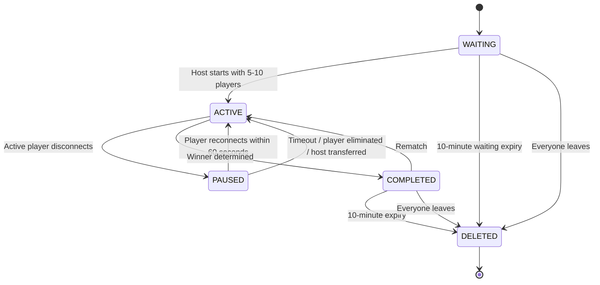

# System Design

**Project:** Ancient Magical Book Multiplayer Game  
**Document:** `systemdesign.md`  
**Version:** 1.0  
**Status:** Detailed implementation specification  

---

## 1. Purpose and scope

This document translates the product rules and architecture into implementable state models, commands, events, validation rules, workflows, and test cases.

Source-of-truth documents:
- `techstack.md` — technology choices.
- `prompt.md` — master development instructions and confirmed product rules.
- `arch.md` — component boundaries and deployment architecture.

If this document conflicts with a confirmed product rule in `prompt.md`, stop and report the conflict. Do not silently reinterpret the game.

## 2. Core domain concepts

| Concept | Meaning |
|---|---|
| Room | Private online arena identified by a room code |
| Match | One game played inside a room |
| Player | Authenticated online participant or local offline participant |
| Spectator | Room member who can observe and communicate but cannot play |
| Position | Fixed match position P1–P10 assigned at match start |
| Cell | One of a player's five independent number cells |
| Progress | Character drawing stage for a cell |
| Gun | Weapon state reached after the fifth matching roll |
| Bullet entitlement | A one-shot permission created by a matching roll after the gun exists |
| Turn | One player's opportunity to roll and complete any required shot |
| Event | Accepted state change or relevant room event |
| Host | Room administrator; also a normal player during a match |

## 3. Constants and limits

```ts
export const CELL_VALUES = [0, 2, 4, 6, 8] as const;

export const MIN_PLAYERS = 5;
export const MAX_PLAYERS = 10;

export const MIN_PAGE_NUMBER = 1;
export const MAX_PAGE_NUMBER = 500;

export const BOOK_ANIMATION_MIN_MS = 4_000;
export const BOOK_ANIMATION_MAX_MS = 6_000;
export const DEFAULT_GAME_ANIMATION_MS = 1_000;

export const RECONNECT_WINDOW_MS = 60_000;
export const WAITING_ROOM_TTL_MS = 10 * 60_000;
export const COMPLETED_ROOM_TTL_MS = 10 * 60_000;

export const USERNAME_CHANGE_COOLDOWN_MS = 30 * 24 * 60 * 60_000;
```

Valid book outcomes are exactly `0`, `2`, `4`, `6`, and `8`, each with probability 20%.

## 4. Game state model

### 4.1 Type definitions

The following is a conceptual TypeScript model. Refine it into validated production types in `packages/shared` and `packages/game-engine`.

```ts
type CellValue = 0 | 2 | 4 | 6 | 8;
type PlayerPosition = `P${number}`;

type PlayerStatus =
  | "ACTIVE"
  | "ELIMINATED"
  | "DISCONNECTED";

type RoomRole = "HOST" | "PLAYER" | "SPECTATOR";

type MatchPhase =
  | "WAITING"
  | "ACTIVE"
  | "PAUSED"
  | "COMPLETED"
  | "DELETED";

type TurnPhase =
  | "AWAITING_ROLL"
  | "AWAITING_SHOT"
  | "RESOLVING"
  | "TURN_COMPLETE";

type CellProgress = 0 | 1 | 2 | 3 | 4 | 5;

interface CellState {
  value: CellValue;
  destroyed: boolean;
  progress: CellProgress;
  hasGun: boolean;
}

interface PlayerState {
  playerId: string;
  username: string;
  avatarId: string;
  position: PlayerPosition;
  status: PlayerStatus;
  cells: Record<CellValue, CellState>;
  kills: number;
  connected: boolean;
}

interface TurnState {
  currentPlayerId: string | null;
  turnNumber: number;
  phase: TurnPhase;
  rolledCell: CellValue | null;
  pendingShot: boolean;
}

interface MatchState {
  matchId: string;
  roomId: string;
  phase: MatchPhase;
  players: PlayerState[];
  spectators: string[];
  turn: TurnState;
  winnerPlayerId: string | null;
  startedAt: number | null;
  completedAt: number | null;
  totalTurns: number;
  version: number;
}

interface RoomState {
  roomId: string;
  roomCode: string;
  hostPlayerId: string;
  phase: MatchPhase;
  playerIds: string[];
  spectatorIds: string[];
  createdAt: number;
  expiresAt: number | null;
  match: MatchState | null;
  version: number;
}
```

Implementation notes:
- Do not use a JavaScript object keyed by numeric values without carefully handling serialization. A `Record<CellValue, CellState>` is a TypeScript type illustration; JSON serialization converts object keys to strings.
- `progress` values mean: 0 = empty, 1 = face, 2 = body, 3 = legs, 4 = hands/arms, 5 = gun.
- `hasGun` must be consistent with `progress === 5`. It may be derived instead of stored.
- A destroyed cell is permanently unavailable. Preserve its previous progress only if needed for temporary event presentation; its gameplay status is destroyed.
- `kills` is match-only state. Do not persist it to the user profile.
- `DISCONNECTED` is a temporary connection status. It is not the same as `ELIMINATED`.

### 4.2 Cell state invariants

For every cell:
1. `destroyed === true` means the cell cannot progress, receive bullets, or be targeted.
2. `progress` is in the inclusive range 0–5.
3. `progress < 5` means no gun exists.
4. `progress === 5` means the gun exists.
5. A cell cannot hold stored bullets.
6. A bullet is a temporary turn entitlement, not an inventory count.
7. Each player's five cell values are unique and exactly `[0, 2, 4, 6, 8]`.

## 5. Character progression and shot resolution

### 5.1 Matching roll transition

For the current player and rolled cell:

```ts
function resolveMatchingRoll(cell: CellState):
  | { kind: "WASTED_TURN" }
  | { kind: "DRAW_PART"; nextProgress: CellProgress }
  | { kind: "REQUIRE_SHOT" } {
  if (cell.destroyed) {
    return { kind: "WASTED_TURN" };
  }

  if (cell.progress < 5) {
    return {
      kind: "DRAW_PART",
      nextProgress: (cell.progress + 1) as CellProgress,
    };
  }

  return { kind: "REQUIRE_SHOT" };
}
```

When `progress` changes from 4 to 5, the gun is drawn with zero bullets and the turn completes. It does not shoot on that same roll.

When `progress` is already 5, a matching roll creates exactly one mandatory shot entitlement.

### 5.2 Mandatory shot flow

After a matching roll on a cell that already has a gun:
- Set turn phase to `AWAITING_SHOT`.
- Store the rolled cell as the source of the shot entitlement.
- Do not increment any persistent bullet count.
- Require exactly one valid shot before the turn can complete.
- If no valid opponent target exists, the current player wins immediately.
- If a valid target exists, the player must select one opponent's undestroyed cell.

On a valid shot:
- Atomically consume the pending shot entitlement.
- Destroy exactly one target cell.
- Track cell destruction: each destroyed cell counts as a cell kill for match statistics, while player eliminations are tracked separately in the temporary event log. The victory screen should label this clearly.
- If all five target cells are destroyed, mark target player `ELIMINATED`.
- If only one active player remains, complete the match immediately.
- Otherwise complete the current turn and advance to the next eligible player.

### 5.3 No valid target

Before asking the player to select a target, the server checks whether at least one other active player's undestroyed cell exists.

If none exists:
- Do not leave the player stuck in `AWAITING_SHOT`.
- Complete the match immediately.
- Declare the current shooter winner.
- Emit a `MATCH_WON` event with reason `NO_VALID_TARGETS`.

## 6. Turn order algorithm

Player positions are assigned once when the host starts the match.

At the end of a completed turn:
1. Find the current player's position in the fixed ordered player list.
2. Scan forward cyclically.
3. Skip players whose status is `ELIMINATED`.
4. Select the next active player.
5. Increment the turn number when the next turn begins.
6. If one or fewer active players remain, finish the match instead of advancing.

Do not reorder players after an elimination or host transfer.

### 6.1 Wasted turn

If the current player rolls a number corresponding to a destroyed cell:
- Emit a wasted-turn event.
- Do not change any cell.
- Do not create a shot entitlement.
- Advance to the next eligible player.

### 6.2 Turn idempotency

Every client command must include a unique `commandId`. The server must prevent duplicate command processing. A retry of an already accepted command returns the original result or current state; it must not apply the action twice.

## 7. Shooting rules and validation

A `SHOOT_REQUEST` is valid only if all conditions hold:

1. Match phase is `ACTIVE`.
2. Sender is an active player.
3. Sender owns the current turn.
4. Turn phase is `AWAITING_SHOT`.
5. A pending shot entitlement exists.
6. Target player exists and is active.
7. Target player is not the shooter.
8. Target cell belongs to the target player.
9. Target cell is not destroyed.
10. Command version/turn identifier is current.
11. Command has not already been processed.

On success, one transaction or equivalent atomic operation must:
- Consume the pending shot.
- Mark the target cell destroyed.
- Update target player elimination if all five cells are destroyed.
- Update temporary match statistics.
- Determine match completion.
- Advance the turn if the match continues.
- Append the accepted event and increment state version.

A client must not be allowed to select a destroyed cell. The server rejects the request without consuming the shot; the player can then choose a valid cell. The UI should prevent selecting destroyed cells in the first place.

## 8. Random number and page generation

### 8.1 Uniform outcome selection

Use a cryptographically secure random source on the server. Avoid modulo bias. Use a bounded-integer API that provides a uniform integer in `[0, 4]`, then map:

```ts
const outcomes = [0, 2, 4, 6, 8] as const;
const outcome = outcomes[secureRandomInt(0, 5)];
```

### 8.2 Page number selection

For a selected ending digit, construct the valid set of page numbers from 1 through 500 whose final decimal digit equals that outcome. Choose uniformly from that set using secure randomness.

Examples:
- Outcome 0: 10, 20, ..., 500. (Do not use page 0 because the range starts at 1.)
- Outcome 2: 2, 12, ..., 492.
- Outcome 4: 4, 14, ..., 494.
- Outcome 6: 6, 16, ..., 496.
- Outcome 8: 8, 18, ..., 498.

The page number is a presentation value. The selected outcome remains the authoritative game result.

### 8.3 Verifiable randomness protocol

Implement a documented cryptographic commit-and-reveal design before enabling online public matches.

Minimum conceptual flow:
1. Server creates a secret seed for the match or roll sequence.
2. Server publishes a cryptographic commitment to the seed before the relevant outcome is revealed.
3. Outcome generation includes the committed seed and a unique roll counter/context.
4. After the agreed reveal point, server reveals the seed or proof material.
5. Clients independently recompute the outcome and compare it with the published result.
6. Clients display verification success or failure.

Protocol requirements:
- Use a standard cryptographic hash and a well-reviewed construction.
- Bind the commitment to the room/match ID, roll counter, and protocol version.
- Prevent seed reuse across matches.
- Define when the seed is revealed so future outcomes cannot be predicted prematurely.
- Define behavior if the server disconnects or fails to reveal.
- Avoid revealing a seed that exposes future outcomes while a match is still active.

A simple commit of one seed followed by immediate reveal may reveal future outcomes. Prefer per-roll commitments or a properly designed hash-chain/VRF-style scheme. Have the protocol reviewed before production. Do not claim verifiability until independent client verification is implemented and tested.

## 9. Match lifecycle state machine



The `PAUSED` state freezes gameplay commands while preserving room communication where appropriate. Only reconnection/timeout control operations are accepted while paused.

## 10. Room and player roles

### 10.1 Roles
- `HOST`: room administration privileges plus normal player privileges while active.
- `PLAYER`: active player privileges.
- `SPECTATOR`: view and communication privileges only.

Host role and player position are separate. A host transfer does not change player positions.

### 10.2 Lobby rules
- Host creates room.
- Room code is generated with sufficient entropy and collision checking.
- Authenticated players join.
- Room can have no more than 10 active players.
- Host starts only when there are at least 5 active players.
- Host can kick players only while waiting.
- External spectators can join during active matches without using player slots.
- The room code remains the same for rematches.

### 10.3 Start match
At start:
1. Verify host authorization.
2. Verify room is waiting.
3. Verify active player count is 5–10.
4. Securely shuffle the active player list.
5. Assign P1 through Pn.
6. Create five empty cells for every player.
7. Set the first turn to P1.
8. Set match phase to `ACTIVE`.
9. Commit the state and broadcast `MATCH_STARTED`.

## 11. Disconnect, reconnect, and host transfer

### 11.1 Disconnect
When an active player's connection is lost:
- Mark their connection status disconnected.
- Pause the entire match.
- Record `disconnectDeadline = serverNow + 60_000`.
- Broadcast `MATCH_PAUSED`.
- Reject gameplay commands until resume.

### 11.2 Reconnect
A reconnect request must:
- Authenticate the same account identity.
- Prove membership in the room.
- Bind the new connection to the existing player identity.
- Arrive before the server-side deadline.

On success:
- Restore the latest committed state.
- Clear the disconnect deadline.
- Resume the match.
- Broadcast `PLAYER_RECONNECTED` and `MATCH_RESUMED`.

### 11.3 Timeout
If the deadline expires:
- Atomically mark disconnected player eliminated.
- Destroy all five cells.
- If the disconnected player was host, transfer host role to the lowest-numbered surviving player.
- Resume the match if at least two active players remain.
- If one active player remains, complete the match.
- If the timed-out player was current turn owner, advance to the next eligible player.

The server owns the deadline. Client countdowns are display-only.

### 11.4 Voluntary leave
- Host cannot voluntarily leave an active match.
- A regular active player may leave; immediately eliminate them and destroy all five cells.
- An eliminated player may leave at any time.
- External spectators may leave and rejoin using the room code while the room exists.
- If everyone has left, delete the room and all temporary data immediately.

## 12. API and command contracts

### 12.1 HTTP endpoints

| Method | Path | Purpose |
|---|---|---|
| POST | `/api/rooms` | Create a room |
| POST | `/api/rooms/:code/join` | Join as player or spectator |
| POST | `/api/rooms/:code/leave` | Leave room |
| POST | `/api/rooms/:code/start` | Host starts match |
| POST | `/api/rooms/:code/kick` | Host kicks lobby player |
| GET | `/api/rooms/:code/snapshot` | Retrieve authorized room/match snapshot |
| POST | `/api/rooms/:code/rematch` | Host initiates rematch, subject to agreed lobby flow |
| GET | `/api/rooms/:code/report` | Host downloads temporary report |

All online endpoints require a valid Firebase ID token except any deliberately public health endpoint. Room-code access alone must not grant player privileges.

### 12.2 WebSocket client commands

```ts
type ClientCommand =
  | {
      type: "ROLL_REQUEST";
      commandId: string;
      roomCode: string;
      expectedStateVersion: number;
    }
  | {
      type: "SHOOT_REQUEST";
      commandId: string;
      roomCode: string;
      targetPlayerId: string;
      targetCellValue: CellValue;
      expectedStateVersion: number;
    }
  | {
      type: "CHAT_MESSAGE";
      commandId: string;
      roomCode: string;
      message: string;
    }
  | {
      type: "EMOJI_REACTION";
      commandId: string;
      roomCode: string;
      emojiId: string;
    }
  | {
      type: "RECONNECT";
      commandId: string;
      roomCode: string;
      lastKnownStateVersion: number;
    };
```

The server must derive the sender identity from the authenticated connection. Never accept a client-supplied `playerId` as proof of identity.

### 12.3 Server events

```ts
type ServerEvent =
  | { type: "ROOM_UPDATED"; roomVersion: number; payload: unknown }
  | { type: "MATCH_STARTED"; matchVersion: number; payload: unknown }
  | { type: "BOOK_ROLL_ACCEPTED"; matchVersion: number; payload: unknown }
  | { type: "CELL_PROGRESS_UPDATED"; matchVersion: number; payload: unknown }
  | { type: "TURN_WASTED"; matchVersion: number; payload: unknown }
  | { type: "SHOT_ACCEPTED"; matchVersion: number; payload: unknown }
  | { type: "CELL_DESTROYED"; matchVersion: number; payload: unknown }
  | { type: "PLAYER_ELIMINATED"; matchVersion: number; payload: unknown }
  | { type: "MATCH_PAUSED"; matchVersion: number; payload: unknown }
  | { type: "PLAYER_RECONNECTED"; matchVersion: number; payload: unknown }
  | { type: "HOST_TRANSFERRED"; roomVersion: number; payload: unknown }
  | { type: "MATCH_RESUMED"; matchVersion: number; payload: unknown }
  | { type: "MATCH_WON"; matchVersion: number; payload: unknown }
  | { type: "MATCH_COMPLETED"; matchVersion: number; payload: unknown }
  | { type: "CHAT_MESSAGE"; payload: unknown }
  | { type: "EMOJI_REACTION"; payload: unknown }
  | { type: "ROOM_DELETED"; roomVersion: number };
```

## 13. Command validation and error codes

| Code | Meaning |
|---|---|
| `UNAUTHENTICATED` | Missing or invalid authentication |
| `ROOM_NOT_FOUND` | Room does not exist or expired |
| `ROOM_FULL` | Active player capacity reached |
| `ROOM_NOT_WAITING` | Lobby action attempted after start |
| `NOT_HOST` | Host-only action attempted by another user |
| `NOT_YOUR_TURN` | Player attempted an action out of turn |
| `MATCH_NOT_ACTIVE` | Gameplay action while not active |
| `MATCH_PAUSED` | Gameplay action while disconnected player pause is active |
| `CELL_DESTROYED` | Attempt to use or target a destroyed cell |
| `SHOT_NOT_AVAILABLE` | No pending mandatory shot |
| `INVALID_TARGET` | Target is self, missing, eliminated, or otherwise invalid |
| `DUPLICATE_COMMAND` | Command was already processed |
| `STALE_STATE` | Client command references an old state version |
| `SPECTATOR_FORBIDDEN` | Spectator attempted gameplay action |
| `RATE_LIMITED` | Request rate limit exceeded |
| `RECONNECT_EXPIRED` | Reconnection deadline passed |

## 14. Event log design

```ts
interface MatchEvent {
  eventId: string;
  matchId: string;
  sequence: number;
  type: string;
  actorPlayerId?: string;
  actorUsername?: string;
  actorPosition?: PlayerPosition;
  targetPlayerId?: string;
  targetUsername?: string;
  targetPosition?: PlayerPosition;
  cellValue?: CellValue;
  outcome?: CellValue;
  pageNumber?: number;
  serverTimestamp: number;
  metadata?: Record<string, string | number | boolean>;
}
```

## 15. Minimal persistent data model

### 15.1 User profile
```ts
interface UserProfile {
  uid: string;
  username: string;
  usernameNormalized: string;
  avatarId: string;
  avatarVariantId?: string;
  usernameLastChangedAt: number | null;
  experiencePoints?: number;
  unlockedCosmeticIds?: string[];
  createdAt: number;
  updatedAt: number;
}
```

### 15.2 Temporary room document
```ts
interface TemporaryRoomRecord {
  roomId: string;
  roomCode: string;
  hostPlayerId: string;
  phase: "WAITING" | "ACTIVE" | "PAUSED" | "COMPLETED";
  playerIds: string[];
  spectatorIds: string[];
  createdAt: number;
  expiresAt: number;
  version: number;
}
```

### 15.3 Temporary match record
```ts
interface TemporaryMatchRecord {
  matchId: string;
  roomId: string;
  serializedState: MatchState;
  latestEventSequence: number;
  randomnessProtocolVersion: string;
  randomnessVerificationState: unknown;
  startedAt: number;
  updatedAt: number;
  expiresAt: number;
  version: number;
}
```

## 16. Username rules
- Usernames are globally unique, case-insensitive for uniqueness.
- Store a normalized value for lookup, such as trimmed lowercase Unicode-normalized text.
- Enforce length range (3–20 characters).
- Reject control characters, invisible formatting abuse, and unsupported characters.
- Escape output when displayed.
- Apply the 30-day change cooldown on the server.
- Username reservation must be atomic.

## 17. Chat and emoji reaction design
- Chat available to active players, eliminated players, and external spectators (online only).
- Messages are room-scoped and rate-limited.
- Do not persist chat after room deletion.
- Do not store voice recordings.
- Reactions: standard and game-themed sets, rendered as temporary floating visual effects. Never affect game state.

## 18. Sound and animation settings
Provide independent controls for:
- Background music.
- Book opening and page flipping.
- Shooting and destruction.
- UI interaction sounds.
- Voice chat.

Settings are stored locally on device.

Animation durations:
- Book opening: 4–6 seconds.
- General UI/game interactions: ~1 second.
- Ordinary cell destruction: short cinematic.
- Final-cell player elimination: special full-screen cinematic.
- Victory: cinematic, winner showcase, and match-only statistics.

## 19. Match report
- Downloadable by host only, post-match and before 10-minute room deletion.
- Temporary report generated on-the-fly (JSON/text).
- Not stored permanently.

## 20. Cosmetic progression without match history
- Evaluate XP/achievements in-memory during match.
- On match completion, update only cumulative XP and unlocked cosmetic IDs on user profile.
- Discard temporary match records.

## 21. Room expiry and cleanup
- Waiting room: 10-minute expiry; delete immediately if everyone leaves.
- Active room: Delete immediately if everyone leaves.
- Completed room: 10-minute expiry; delete immediately if everyone leaves.
- Cleanup removes all temporary documents, event logs, and randomness proof material.

## 22. Offline persistence
- IndexedDB via `idb`.
- Save after every accepted local action.
- Automatic restore on page refresh or browser reopening.
- Local data never uploaded. Clear button provided.

## 23. Required test cases
Full test coverage as specified across Game Engine, Randomness, Rooms and Roles, Disconnect & Lifecycle, Security & Concurrency, Offline & UI.

## 24. Implementation order
1. Shared types and pure game engine.
2. Unit tests for every game rule and edge case.
3. Offline game runtime and IndexedDB recovery.
4. Responsive battlefield UI and book result flow.
5. Online authentication and room lifecycle.
6. Authoritative server game service.
7. WebSocket synchronization and command idempotency.
8. Reconnection, timeout, and host transfer.
9. Verifiable randomness protocol and independent verification.
10. Spectator access, event log, chat, and reactions.
11. Voice infrastructure after cost evaluation.
12. Cinematics, sound settings, avatars, cosmetics, and tutorial.
13. Security, load, PWA, and cleanup validation.

